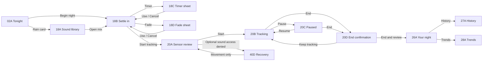
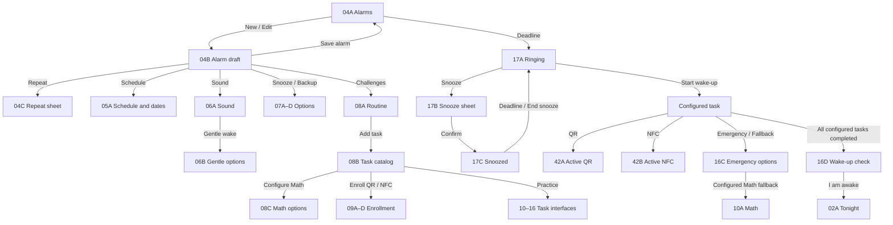
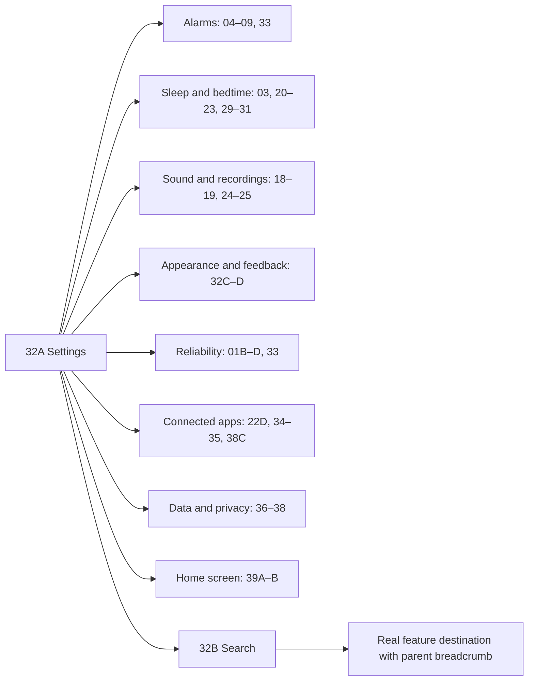

# SleepWell — navigation and flow map

This map specifies intended routes between the visual states. Board captions are illustrative; the route tables in START-HERE.md govern Save, Back and alternative branches.

## Everyday night

If End was opened while paused, Keep tracking returns to the paused state rather than silently resuming. The state table preserves that branch.

## Build an alarm and get up

A child Save/Use updates the alarm draft. Final Save alarm commits it. Practice is a separate non-alarm mode. An ignored main alarm can independently reach 17D backup ringing.

## Find advanced features

## Review, corrections and data

- Your night 26A → graph 26B / sound event 26C / edit 26D.
- Edit 26D → tags/quantity 41A–B; Save returns to the same night; dirty Back opens 40B.
- Restore original 41D shows a comparison before changing the displayed edits.
- History 27A → calendar 27B / manual period 27C / import review 27D.
- Trends 28A → rhythm 28B / tag comparison 28C / chronotype availability 28D.
- Privacy 36A → export review 36B / restore review 36C / erase scope 36D.
- Backup folder 37A → versions 37B → conflict review 37C → restore preview 36C.
- Share 38B opens the Android chooser only after review. Research sample 38D exports a file; it does not establish a hosted research service.
- Recovery 40A/C/D and empty/loading states 43A–D return to their actual invoking parent.

