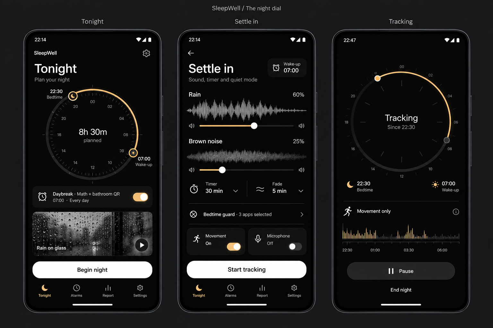

# SleepWell design contract

Version 1.0 · 30 October 2026 · Android phone product · Design specification, not implementation acceptance.

This is the primary UI/UX contract for the Night dial redesign. It specifies what to build, how the pieces behave together, and what must be checked before calling a screen finished. The 43 prototype boards are visual studies with 172 identified states; they are not pixel specifications or evidence of working features.

## Contents

- [Authority and the chosen direction](#authority-and-the-chosen-direction)
- [Product principles and information architecture](#product-principles-and-information-architecture)
- [Visual system](#visual-system)
- [Layout and adaptation](#layout-and-adaptation)
- [Component contracts](#component-contracts)
- [Navigation, drafts and state ownership](#navigation-drafts-and-state-ownership)
- [Motion and feedback](#motion-and-feedback)
- [Time, signals and chart language](#time-signals-and-chart-language)
- [Feature-by-feature flow specifications](#feature-by-feature-flow-specifications)
- [All 28 wake challenges](#all-28-wake-challenges)
- [Permission and external-system handoffs](#permission-and-external-system-handoffs)
- [Content, accessibility and recovery](#content-accessibility-and-recovery)
- [Implementation and acceptance](#implementation-and-acceptance)
- [Screen-state registry](#screen-state-registry)
- [Feature coverage](#feature-coverage)

## Authority and the chosen direction

### Source precedence

When sources disagree, use this order:

1. The user's explicit instructions and selected **original Night dial** reference.
2. The normative decisions in this document, including corrections to generated screens.
3. The written flow routes and feature contracts.
4. Prototype compositions as a visual reference.
5. Older Changing light boards, exploratory alternatives and current implementation details.

The product's current behavior, saved data and feature availability must be preserved unless an explicitly described change is required. A mockup cannot authorize a new sensor claim, external service, permission, payment, irreversible action or removal of an existing feature. A later implementation must record any necessary deviation from this contract.

The selected image is [accepted-reference.png](design-concepts/2026-10-29-night-dial-flow-library/accepted-reference.png). The browsable studies are in [the gallery](design-concepts/2026-10-29-night-dial-flow-library/GALLERY.md), with [navigation routes](design-concepts/2026-10-29-night-dial-flow-library/START-HERE.md) and [flow diagrams](design-concepts/2026-10-29-night-dial-flow-library/FLOW-MAP.md).

### What the user selected

**A precise, beautiful instrument that feels like a quiet retreat.** The original reference's hierarchy, substantial dial, crisp typography, amber controls, rain imagery, sound waveforms and overall balance define the direction.

Do not substitute the later stripped monochrome studies, soft charcoal kit, oversized editorial numerals, digital bedside-radio treatment, illustrated Ember/Tidal/Nocturne worlds or daylight palette. “Dark” alone does not satisfy the brief. The product must have the selected composition and texture, not just black backgrounds.

The concept sentence is: **SleepWell's bedtime-to-wake interval becomes the instrument through which a person prepares, records and reviews a night.** Its live interaction is editing that interval with a dial or an equally capable numeric time editor. Waveforms and sound artwork provide the second recognizable element. The instrument belongs on time-related screens; it is not a decorative frame for every setting.

### How the taste skill applies

This is an app-screen specification. Use the design-taste app-screen rules, not the marketing-page sequence or page motion quota. The earlier draw was True-black flat, seed 1500156160. The user-selected reference deliberately overrides that draw's strict accent budget and brightness-only navigation: amber switches, selected navigation and sliders remain. The reference also authorizes a large functional clock and rounded media cards.

These are scoped exceptions, not permission for color everywhere. Keep flat surfaces, one type family, one accent, honest charts, quiet hierarchy and complete states. Do not add scroll reveals, a motion minimum, an imagery minimum per screen, hero slogans, KPI tiles or a desktop sidebar to imitate a web gallery.

## Product principles and information architecture

### Ten things the interface must express

- A person's next wake-up and tonight's preparation are the central objects.
- Alarms and tracking are related but independent: recording failure must not imply the fixed alarm was canceled.
- The user can use an alarm, play sounds or track movement independently.
- Phone movement is measured movement, not clinical sleep stages.
- Sound analysis is optional; saving playable clips is a separate choice.
- The product stores data locally by default and supports explicit, scoped exchange.
- Wake challenges should help a drowsy person complete a clear task without losing emergency access.
- Advanced features remain findable through named destinations and search.
- Missing data, estimates and imported data keep their provenance.
- Opening a page is never itself permission to play audio, record, connect, share, arm or delete.

### First question per root

| Root | First question | Dominant object | Primary job |
| --- | --- | --- | --- |
| Tonight | What is my plan for this night? | Bedtime-to-wake dial | Begin night |
| Alarms | What will ring next? | Next enabled alarm and its schedule | Create or edit an alarm |
| Report | What was recorded, and what needs review? | Recorded duration with supporting signals | Review the selected night |
| Settings | Where can I change this behavior? | Named categories and search | Open the relevant settings group |

Use exactly these four root tabs, in this order. Labels remain visible. No fifth Sound or Discover tab. Sound library, naps and plans have clear Tonight entry points and secondary settings routes.

### Settings taxonomy

Preserve the newer discovery improvements documented in [UI-ORGANIZATION.md](docs/UI-ORGANIZATION.md). Use these eight root entries rather than reverting to the older labels generated in board 32A:

| Canonical entry | Contains |
| --- | --- |
| Alarms | Manage alarms, future-alarm defaults, protection, schedules/calendar rules, naps and code enrollment |
| Sleep tracking | Manual setup, automatic tracking, sensors, room conditions, awake estimates, sleep plan, rhythm, diary, travel |
| Sound analysis | Analysis, clips, categories, retention, favorites, cues, offline recorded-audio estimates; link to Sleep sounds |
| Bedtime guard | Schedule, installed-app selection, access status and temporary pause |
| Appearance | Night dial theme, text, contrast, motion, feedback, Tonight layout, home-screen tools |
| Reliability | Notifications, exact alarms, full-screen alarm access, background restrictions, diagnostics and explicitly initiated tests |
| Integrations | Health Connect, calendars, lights, automations, paired phones, PIR and connected-app access |
| Data & privacy | Local storage, scoped export, JSON backup, restore, folder versions, audio backup, portable profiles and erase |

“Sleep & bedtime” in an older board maps to Sleep tracking; “Connected apps” maps to Integrations; “Home screen” lives under Appearance; “Sound & recordings” maps to Sound analysis. Search indexes both familiar aliases and canonical labels. A search result shows the canonical breadcrumb.

Report has a visible **Night / History / Trends** switch beneath its header. These are views of Report, not additional bottom tabs. History and Trends remember their own range/filter/scroll state. Do not hide them exclusively in overflow.

### Findability and depth

From a root, the common task must be visible without opening an overflow: Begin night, Add alarm, Night/History/Trends, Settings search, Bedtime guard and Sound analysis. Supporting tools may be two or three steps deep, but must have a named parent, a search result and an ordinary Back route.

More/Options menus contain commands or secondary destinations, not every important feature. Keep a maximum of six visible commands before using a named detail page. Do not manufacture a menu called “Advanced” containing unrelated controls.

### Typical journeys

- **Prepare:** Tonight → adjust plan if necessary → Begin night → Settle in → review sensors → Start tracking.
- **Sound only:** Tonight rain card → Sleep sounds → select/preview → mixer → Play. Tracking remains off.
- **Alarm only:** Alarms → New alarm → time/repeat/sound/challenges → Save alarm. Tracking remains off.
- **Get up:** Ringing → configured routine → optional wake-up check → Tonight/Report.
- **Review:** Report Night → inspect a point/event → correct or annotate → Save → same night.
- **Correct absence:** Report History → missing date → Add manual night → review provenance → Save.
- **Find a setting:** Settings search → choose alarm if necessary → actual setting → Back restores search context.
- **Move data:** Data & privacy → choose scope → review → native destination → explicit completion/receipt.

## Visual system

All sizes below are **design targets**, not measurements extracted from generated pixels. Use dp for layout and sp for text. One token registry governs native screens, custom graphics, dialogs, notification artwork and future prototype implementations.

### Color roles

| Token | Value | Use |
| --- | --- | --- |
| ground | #080808 | App background and root navigation ground |
| surface | #171717 | A grouped setting, sound row or ordinary card |
| raised | #242424 | Sheet, menu, popup and focused media player |
| pressed | #303030 | Neutral pressed treatment; never permanent elevation |
| primaryText | #F3F3EF | Reading text, headings, time |
| secondaryText | #B8B8B3 | Supporting sentence and inactive navigation |
| metaText | #9C9C97 | Axes, source notes and timestamps when contrast holds |
| accent | #F2BF6D | Plan arc, active switch, selected radio/tab/nav, slider fill |
| accentPressed | #DDA95B | Amber pressed fill |
| accentText | #17120B | Text/icons on amber |
| primaryAction | #F3F3EF | Filled pill action in preparation/review |
| primaryActionText | #111111 | Text on the primary action |
| secondaryAction | #2A2A2A | Secondary pill action |
| subtleRule | #2C2C2C | Sparse structural separators |
| controlOutline | #767671 | Necessary interactive boundaries on dark surfaces |
| disabledFill | #242424 | Disabled track/button surface |
| disabledText | #9C9C97 | Legible disabled label plus a reason |
| negative | #F18B8B | Error mark, inline error text, destructive label |
| negativeSurface | #321D1D | Local error/confirmation context |
| success | #91CDA5 | Small verified outcome mark only |
| successSurface | #1A2B20 | Local success context |
| scrim | Black at 60% | Modal separation; no blur |

Measure contrast for the actual composite pair. Normal reading text, metadata and placeholders target at least 4.5:1. Large display text and essential non-text graphical boundaries target at least 3:1. These requirements do not make a subtle decorative panel edge an interactive boundary: controls whose shape conveys interaction need a sufficiently clear edge or fill distinction, even if a 1dp structural rule remains quieter.

Do not use white text on amber. A final destructive button filled with negative #F18B8B uses primaryActionText #111111; ordinary destructive rows use negative text on a dark surface. Do not dim an entire screen/card to signal disabled state; labels remain readable. High contrast strengthens control boundaries and subdued text, not the entire background to white. Semantic red/green are not additional brand accents and must not decorate ordinary rows.

The selected reference permits amber on active chrome. Keep that role consistent across the product; do not rotate accent colors by feature. Most pixels remain black/charcoal. A settings page with amber titles, every icon amber, every card outlined amber and a large amber button fails.

### Night luminance

Dark mode is the default across setup, review, sheets and notifications owned by the app. Never automatically switch to a bright morning screen. Photographs remain small and tonally controlled; no white image placeholder flashes during loading.

Tracking's bedside mode uses the same hierarchy with primaryText #C9C6BC, secondaryText #AAA79F and accent #C5A367, provided actual contrast passes. It follows system brightness; an optional per-window dim action is explicit and reversible. Do not change global brightness or device settings merely by opening tracking. Sunrise wake output is a separately enabled feature, not a theme transition.

Keep the reference's white preparation CTA. In a live bedside session, use a charcoal Pause button and a readable text End night action. End night is not destructive when it saves a record; do not give it a large red fill. Red is for actual deletion or a blocking error.

Existing theme preferences must not be erased. The redesign's default is Night dial; any retained alternate theme requires an explicit preview and Save. Clock-phase appearance cannot brighten tracking automatically or override a user's fixed dark choice.

### Typography

Use bundled **Inter**, including variable weights and tabular numerals. Reuse the licensed asset at app/src/main/assets/fonts/Inter.ttf and its license. Do not import a new typeface for individual screens.

| Role | Size / line height | Weight | Rules |
| --- | --- | --- | --- |
| Clock display | 48 / 52sp | 500 | Main wake time only; shrink to 40sp on compact layouts before reducing body text |
| Dial center duration | 34 / 40sp | 500 | One central answer, not a KPI grid |
| Root title | 30 / 36sp | 600 | Tonight, Alarms, Your night, Settings |
| Detail/sheet title | 24 / 30sp | 600 | Natural title, no uppercase eyebrow |
| Section/row/action | 16 / 24sp | 500–600 | Main field and button labels |
| Body | 16 / 24sp | 400 | Explanations and instructions |
| Supporting/values | 14 / 20sp | 400–500 | Secondary row text and short values |
| Metadata | 12 / 16sp | 400–500 | Axes, source notes; never the sole carrier of an important action |

The two display roles are exceptions to the taste skill's desktop KPI ceiling because the selected reference and drowsy-use task require a prominent clock. Never apply 48sp figures to every statistic. Headings fit within two lines at default scale; at enlarged text, wrap naturally instead of truncating or shrinking essential copy.

Use sentence case. No artificial tracking on small text, serif headings, seven-segment fonts, monospace outside real technical identifiers/payloads, emoji navigation or all-caps buttons. Do not uppercase localized AM/PM by hand. The app follows the person's locale and 12/24-hour preference.

### Spacing, shape and lines

| Role | Target |
| --- | --- |
| Base spacing | 4dp; use 4, 8, 12, 16, 20, 24, 32 |
| Phone outer margins | 20dp each side; 16dp only for a width below 360dp |
| Ordinary grouped surface padding | 16dp |
| Main visual to next block | 24dp |
| Between different sections | 28–32dp |
| Between peer rows/cards | 12dp |
| Ordinary row minimum | 64dp; 76dp with a second line |
| Compact action row minimum | 56dp |
| Minimum interactive hit area | 48 × 48dp |
| Primary action | Minimum 52dp high; content-driven height at larger text |
| Grouped surface/media radius | 20dp |
| Sheet top corners | 24dp |
| Fields, menus and small panels | 12dp |
| Buttons/segments/switches | Fully rounded |
| Structural rule | 1dp, sparse |
| Focus/selected outline | 2dp where needed, not a permanent card border |

No additional radius values per screen. A full-width group of rows is one surface, not a separate bubble around each label. Do not combine resting shadow, border and a bright fill step. Menus may use a restrained shadow solely to explain floating depth; never glow or glass.

### Icons, imagery and material

Use the existing Phosphor regular family consistently, normally 20–24dp visible within 48dp targets. Small metadata glyphs may be 16dp. Use one stroke language; no mixture of emoji, filled stock icons and new boxed line icons. Select a filled variant only where it makes selection clearer and belongs to the same family.

No colored icon containers on every metric or row. Permission, sensor and challenge diagrams may use a purposeful neutral graphic. The wordmark remains simple Inter “SleepWell”; do not invent a new logo during screen implementation.

Rain-on-glass artwork belongs to sleep-sound selection and the Tonight sound card. It does not belong behind Math, error text, a privacy explanation or every challenge. Use consistent source-specific artwork for forest/local sources. A missing artwork asset shows a quiet neutral media surface with the source's name, not a gradient blob.

Raster art must be a standalone background or media crop, never a baked image of the entire interface. Controls, labels, waveforms, chart data and dials are real native elements. Mock camera scenes are not production assets or live camera results. Retain asset provenance and licenses.

## Layout and adaptation

### Phone frame and system bars

The initial target is an Android phone at 390 × 844dp; verify 320, 360, 390 and 432dp widths. Insets are dynamic: status bar, cutout, gesture navigation, three-button navigation and keyboard are not fixed mockup paddings.

Use a dark window background before the first content frame. Set appropriate light system glyphs for the actual surface and restore them after native handoffs, sheets and activity recreation. Never show a cream/plum flash during transition into this design. Do not cover or simulate system status icons in production.

Root layout order is: system inset → header → scrollable content → owned primary action region where needed → root tab bar → system bottom inset. The content's last item remains scrollable above actions. Do not add both a fixed footer and a floating dock that obscure each other.

### Tonight composition

At normal text scale the first viewport contains the title, full night dial, alarm summary, one sound artwork row, Begin night and the tab bar. This is the selected reference's composition. Avoid extra reminders, tips, reliability banners and goal cards above the dial.

Dial diameter is min(320dp, 90% of content width), centered within the shared margins. At 360dp width, 320dp content × 0.90 gives a 288dp dial. Endpoint labels may sit beside the dial but must fit inside the same margins. Reserve their measured width; do not draw labels outside the canvas and hope they fit.

On short screens, first reduce nonfunctional gaps and use a smaller media crop, then let content scroll. Do not shrink reading text below its role. At large text, use a compact dial with separate stacked endpoint rows. “Everything above the fold” never outweighs legibility.

### Detail pages and sheets

A detail page has a 56dp-minimum toolbar with Back and one optional action. A title that needs more than one line expands the toolbar or moves into content. A page does not repeat a giant wordmark, greeting and subtitle above every form.

Use a sheet for a bounded choice or local review, a full detail page for a multi-section configuration. A long audio settings page is not forced into a 40%-height modal.

Sheets use the available height, stopping below the safe top inset; content can scroll and the action area remains reachable. At large text or with the IME, expand to near-full height. In landscape on a short phone, promote to a full-height dialog/detail surface using the same content and parent route.

### Larger windows and foldables

The phone is the canonical composition; no watch UI is implied. On a window at least 600dp wide, use a restrained navigation rail and a centered content column, or list/detail when both panes have at least 320dp usable width. Do not stretch a dial to tablet width or make six giant setting cards in a row.

Use a maximum 560dp reading/form column. Report may place its graph next to source details at sufficient width; keep the key finding and selected-night scope visible in both panes. At a fold hinge, no handle, critical text or primary action crosses the occluded region. Window resizing retains the draft, current task and selected night. Never lock the whole app's orientation to avoid layout work; per-alarm orientation lock applies only where explicitly configured.

### Keyboard and long content

- Focus scrolls the actual field into view, above the keyboard and action bar.
- Dialog buttons remain reachable without dismissing the keyboard to guess where Save went.
- Next moves through related form fields; Done validates/submits only the current explicit form.
- QR names, alarm names, file names and imported tags wrap or ellipsize only the nonessential trailing part. Provide the full value in detail/accessibility text.
- Never render both a custom keypad and the system keyboard at once.
- Root tab bars are not displayed beneath a focused full-screen challenge keyboard.

## Component contracts

Every component implements default, pressed, focused, selected/checked, disabled, pending and failed states where applicable. Restoration is not an input event. No state is conveyed by color alone. Touch, keyboard, TalkBack and accessibility actions invoke the same logical action once.

### Buttons and action rows

| Variant | Appearance | Behavior |
| --- | --- | --- |
| Primary | White pill, dark 16sp/600 label | One main action per surface; full width on major phone forms |
| Secondary | Charcoal pill, primaryText | Cancel, Keep tracking, bounded preview |
| Text action | Readable text with 48dp hit area | Secondary navigation or End night; no invisible gesture dependence |
| Destructive | Negative label; negative fill only in final confirmation | Names the object/scope; separate from a normal Save |
| Icon action | Plain family icon within 48dp target | Accessible verb/name; no unlabeled mystery action |
| Command row | Label and optional chevron; no radio | Open, Export, Rename, Duplicate, Clear, Test or Delete |

Pressed changes fill/tint without changing text position, width, radius or elevation. Focus has a 2dp visible outline; focus and selection may coexist. A busy button retains width and label context (“Saving…”), shows a small progress mark and rejects duplicate activation. Other independent navigation stays usable unless leaving would invalidate the operation.

A disabled primary action shows why close to it: “Enroll a code to add this task.” Do not use a toast to explain an invisible prerequisite. Do not show “Saved” before a successful commit. A temporary input acknowledgment is not asynchronous success.

A command list is not a radio group: selecting Export does not leave a checked Export row. Use rows named by verbs. For a long operation, the visible state belongs to the operation, not just the button.

### Setting rows

A setting row may have exactly one primary affordance:

- **Destination:** label/value/chevron; whole row opens the destination.
- **Immediate toggle:** label/state/switch; row and switch toggle the same value once.
- **Draft toggle:** identical geometry, but the page's Save/Use owns persistence.
- **Single choice:** radio or selected segment; row selects a value.
- **Status with action:** status text plus Review/Retry; it does not masquerade as a grant switch.
- **Command:** verb, optional consequence, no saved selection indicator.

Do not combine a chevron and a switch that perform different actions in one undivided hit area. If details are needed beside a toggle, give the information action its own named 48dp target. Route and value summaries align on the same edges. Text wraps before it collides with a trailing control.

### Switch

Visual track 52 × 32dp, radius 16dp; thumb 24dp with 4dp interior inset. Off thumb center is 16dp from the left; On center is 36dp. The 20dp travel stays inside the track. Hit area is at least 48dp tall and 48dp wide, normally the full row.

On uses accent track and a light thumb; Off uses neutral track. A small dark check inside the thumb may reinforce On, but cannot protrude or substitute for its accessible checked state. Do not invent a minus symbol for disabled. Disabled uses unchanged geometry with muted fill/text and a reason.

One tap anywhere in the row changes one value once. Drag snaps at the midpoint, cancel restores the previous value and accessibility set-progress is not misused for a Boolean. While awaiting a commit, keep a stable pending state and ignore repeated toggles. On failure restore the actual saved value and show an inline error.

For choices such as protection or automatic tracking, **saved intent and operational readiness are separate facts**. Show “On · Access required” if that is the saved configuration. Do not falsely claim a permission was granted, or silently turn the saved choice off when Android access is absent.

### Radio, checkbox and segments

A single-choice list uses a 20dp radio with a visible neutral boundary, 10dp selected dot and an accessible selected state. Entire row is selectable. The selected row may use a subtle neutral/amber tonal step; never both a bright border and a saturated fill.

Checkboxes are for independent selections or bulk operations. Their selected count equals the actual selectable items. “Select all” describes its scope and supports partial selection. Disabled duplicate/import rows are excluded from the actionable count.

Segments have a minimum 48dp overall hit height. Week/Month/Year, timer presets and task categories preserve selection without moving the whole page. Selected segments use amber with dark text; unavailable choices stay readable with their explanation. Tabs that navigate are not used to edit a stored value.

A time/duration preset edits the same draft as typed input. Valid typing updates the selected preset; a custom value deselects all nonmatching presets. Do not leave “30 min” highlighted after the user types 45.

### Sliders and steppers

Default slider track 4dp, inactive neutral, active amber, 24dp thumb and at least a 48dp interaction lane. Put a stable numeric value on the same row as its label. Units stay visible. Volume/gain is a percentage of its stated control, not a loudness or dB claim.

Dragging previews the draft continuously when safe. It does not persist every pointer move. Release commits only in an immediate-save context; draft pages wait for Use/Save. Cancel returns the original draft. Accessibility exposes minimum, maximum, step and named increment/decrement actions.

Steppers have separate 48dp Minus/Plus targets with the number between. At a bound, the unavailable action stays in place with disabled semantics. Long press may repeat with bounded acceleration, but never jumps beyond the model range or emits a haptic every frame. Support typing an exact value where practical.

No control introduces a second, visually different source of truth for the same setting.

### Text fields, names and secrets

Fields have persistent labels, values and units; a placeholder is only an example. Minimum 52dp height, surface/raised fill, visible control boundary and a 2dp accent focus ring. Error text sits directly below the field without covering the next action. Do not show simultaneous native popup errors, a toast and a custom inline error.

Validate while leaving the field or explicitly submitting. During ordinary typing preserve an incomplete but plausible value; do not reset it to a default on every keystroke. Invalid submission focuses the first invalid field and explains how to fix it. Never normalize a typed duration/time into a materially different value without review.

Alarm/code names use ordinary text input; time/duration uses an appropriate numeric input. URL fields disable inappropriate capitalization, keep the scheme visible and expose the complete destination during review. Tokens/passwords remain masked, with a separate Show/Hide action. A failed connection must not print secrets in visible errors, copied diagnostics or screenshots.

### Time, date and duration editors

- Use the same custom dark time editor across Tonight, alarms, naps and record edits, with a native accessible fallback where needed.
- Hour/minute columns have a stable selection band. Adjacent values are secondaryText, not unreadable black-on-black. Wheel changes use real values; the keyboard alternative is always reachable.
- A 12-hour editor includes an explicit AM/PM choice. A 24-hour editor shows 00–23, never 24:xx.
- Duration is not a clock: use labeled hours/minutes/seconds, model-valid presets, exact input and a calculated total.
- A date picker uses locale week start, real month lengths and calculated weekday labels. Selected date, today and dates containing records have distinct marks.
- Excluded dates are multi-selection; next-only occurrence is single selection. Explain which is being edited.
- “Tomorrow” must be accompanied by a date where recurrence/time-zone ambiguity matters.
- Show the configured range and validation for each caller; a generic picker cannot ignore that caller's bounds.
- Use/Apply returns to the invoking draft. Cancel, Close, drag-dismiss and Back restore the previous value.
- A date/time change with DST ambiguity shows the resolved zone/offset before committing; do not silently pick a different occurrence.

### Sheet, dialog and popup

| Surface | Use | Dismissal |
| --- | --- | --- |
| Bottom sheet | Timer, fade, repeat, local consent explanation, scoped choice | Close/Back/outside tap; dirty changes use a discard gate |
| Detail page | Alarm sound/gentle, advanced tracking, multi-section integration | Back to real parent; preserve/resolve dirty draft |
| Centered confirmation | Destructive action or interruption that needs an explicit choice | Cancel on Back/outside; never confirm by dismissal |
| Anchored menu | A short list of commands | Tap a command or dismiss; return focus to trigger |
| Tooltip | A selected chart point or concise explanation | Close/tap elsewhere/Back, never blocks a primary action |

A sheet has a 32 × 4dp neutral handle, 20dp horizontal content margins, title, a 48dp close action and a clearly owned action area. One sheet is visible at a time. Opening a second choice replaces the sheet content or presents a detail page with a visible return; do not stack floating popups over the existing sheet.

Anchored menus appear next to their trigger if space exists. If they would cover another necessary setting or the keyboard, promote the menu to a sheet. A sound chooser covers the parent with a proper sheet rather than covering Challenges while exposing a disconnected Save button.

The modal scrim is black at 60%, has no blur and blocks interaction with the parent. Underlying content remains recognizable. TalkBack focus moves to the title and stays inside; dismissal restores focus to the trigger. Modal completion returns to the actual caller, including search or a nap editor, not a hardcoded Tonight screen.

### Confirmations, undo and messages

Confirmations name the action and object: “Delete ‘Daybreak’?” with its schedule, “Delete 8 recordings?” with retention consequences, “Restore original times?” with a before/after comparison. Buttons name the action, not Yes/OK.

Ordinary Back from a dirty editor offers **Save / Discard / Keep editing** if that editor owns a save operation. A child picker offers Use/Cancel and must not save the entire alarm. Destructive confirmation has **Cancel / Delete**; dismissal equals Cancel.

Use undo for reversible local deletion/skip operations only when the state is actually recoverable. The design target is an 8-second snackbar, extended by the platform accessibility timeout. Undo is an additional convenience; it must not be the only way to discover a major schedule change. Data erase with no recovery has no fictional Undo.

A snackbar sits above bottom actions/navigation, contains one short result and at most one action, and never covers input. Persistent failures use an inline message or status row. Loading, error, stale and success are mutually exclusive phases of the same operation; do not show a completed success card on a denied-permission page.

### Media card, player and sound picker

Tonight's default rain card is one full-width landscape crop, about 112–136dp high depending on available height, with its label on a real neutral scrim only if needed for contrast. A separate 48dp Play/Pause action remains recognizable. Tapping artwork/label opens the sound detail; tapping Play previews/plays and does not navigate.

The library uses one dominant selected artwork followed by a small number of source rows. No generic promotional carousel, recommendations feed, premium badge or subscription store. A compact player stays in the content/action region above root navigation while audio is active; it never creates a floating glass dock.

The selected sound uses a radio. Previewing uses Play/Pause and a “Preview” label. These can differ. Only one preview plays at a time. Pressing Stop stops actual playback; closing a selector stops its bounded preview, while closing a mixer need not stop user-started ongoing audio. The visible state must say which case applies.

Mixer tracks use source names, real per-layer gains and functional waveform/progress. Static waveform artwork represents a bundled source, not live microphone capture. A missing waveform uses a simple duration/progress strip; do not fabricate signal data to fill the space.

### Empty, pending, stale and error surfaces

| State | Required display |
| --- | --- |
| Empty first run | Name the missing object, show the next useful action; no fake chart |
| Zero measurement | Actual zero with its unit, distinct from unavailable |
| Unavailable | Em dash or “Unavailable,” a reason and an alternative if one exists |
| Initial loading | Final frame and labels; neutral bars where values will appear; no shimmer |
| Refreshing | Last good values stay, small updating indicator, selected range/scroll retained |
| Failed refresh | Updating ends; last-good timestamp and local Retry; old data stays |
| Uncertain estimate | Explicit estimate/source and review/correction route |
| Partial operation | Completed count, failed count and actionable retry scope |
| Read-only imported source | Source name, original values and exact-export route; no silent reinterpretation |

No endless spinner for an impossible prerequisite. Distinguish “Waiting for a sample” from “This device has no sensor.” Cancel stops the owned test/request. A fresh retry does not duplicate a record, restart an alarm or create another preview.

## Navigation, drafts and state ownership

### Back stack and state restoration

Each root keeps its own stack, selected object, filters and scroll. Switching roots changes no saved choice. Returning restores that root. Reselecting a root returns to its root view after resolving a dirty child; reselecting while already at the root is a no-op, without an extra haptic.

The visible object is identified by a stable ID, not a list position. If a record/alarm disappears while open, show a short “This item is no longer available” state and return to its parent list, preserving other drafts.

Back closes the keyboard first where Android normally does so, then the active transient surface, then the detail page. A predictive-back preview must match the actual destination and must not save/discard merely while the gesture is in progress. Canceling the gesture changes nothing.

Restore drafts, field selection, pending editor value, query, range and scroll after recreation. Do not automatically restart camera/microphone previews, a quiet audio sample, a connection test or a temporary permission request just because a screen is restored. Re-admit the operation with truthful state. Active tracking/alarm sessions are restored from their service/session identity, not from a recreated view's local timer.

### Save ownership

| Context | Owner | Child behavior |
| --- | --- | --- |
| Alarm editor | Final Save alarm | Sound, repeat, snooze, schedule and routine return draft changes |
| Future-alarm defaults | Dedicated Save defaults | Behavior template only; no enabled state, occurrence identity or test execution |
| Sleep plan | Save plan | Linked alarm update has a separate reviewed action |
| Mixer timer/fade | Use timer / Use fade | Applies to the current mix with revision protection |
| Tracking setup | Save configuration / Start tracking distinct | Start reviews sensor admission; opening setup collects nothing |
| Automatic tracking | Save settings / Arm tonight distinct | Save stores preferences; Arm creates an explicit waiting session |
| Guard settings | Save schedule / Save selection | Accessibility grant is an external fact |
| Record editor | Save changes | Original samples remain immutable; manual edits have provenance |
| Integration rule | Save rule | Test delivery is separate and explicitly initiated |
| Profile/restore/import | Reviewed Apply/Restore/Import | File selection and preview do not write |
| Appearance | Save appearance | Live preview is reversible; leaving dirty uses the same gate |

Immediate root actions are limited and explicit: enable/disable an existing alarm, play/pause existing user-started playback, favorite an event, skip/undo one occurrence, pause/resume an active session and confirm being awake. Persist the actual result and show any failure; do not mix autosave switches with a misleading Save button on the same view.

### Asynchronous and concurrent changes

A save result has a request/draft identity. A late completion from an old screen cannot overwrite a newer edit, display success on the wrong alarm or reopen a dismissed popup. If the saved object changed elsewhere, show “This item changed” with Reload / Review my changes; do not silently overwrite.

Pending operations expose Cancel only when cancellation is real. A restore transaction that has reached its final noncancelable commit says “Finishing restore,” blocks duplicate commits and returns an explicit outcome. It does not display a false cancel affordance.

If preferences were saved but runtime setup failed, distinguish “Saved · Access required” or “Saved · Could not schedule” from a failed save. A switch is the saved choice, not proof of delivery. An alarm's next occurrence is computed from actual schedule state; do not infer it from the switch alone.

### Alarm interruption priority

An actual ringing alarm takes precedence over a normal editor, sheet, preview or settings search. Save the suspended UI draft, stop or duck conflicting previews according to the actual audio policy and show the active alarm identity. Do not let the alarm inherit a modal scrim or blocked Back state from the suspended screen.

After dismissal, return to the suspended context when safe, or Report if the user explicitly ended/reviewed the night. Never automatically commit the suspended draft. With multiple alarm occurrences, keep each identity, snooze count, challenge progress and backup authority separate; show another pending alarm as a compact actionable status, not merged or silently dismissed.

A ringing alarm and tracking can coexist. Completing an alarm stops tracking only if the relevant saved option requires it; the UI must indicate that consequence. A fixed deadline remains independently visible when early wake is configured.

## Motion and feedback

### Purpose and budget

Motion explains an input or state transition. It must not delay reading, delay an alarm, disguise a slow operation or manufacture visual activity. The app-screen rule applies: there is no animation quota and no staged entrance for every row.

The one signature motion is **the night dial responding to a deliberate time edit**. During a drag, the handle follows the finger without easing; the interval and exact value update together. On release, a short snap settles onto the chosen minute. This is a useful instrument, not a perpetual animation.

Do not animate all dials from zero on entry, count a saved duration up from zero, play a looping sleeping-breath animation, sweep a fake live waveform, bounce controls, parallax artwork or reveal rows on scroll. No information remains hidden waiting for motion.

### Motion tokens

| Token | Duration | Curve |
| --- | --- | --- |
| Press feedback | 100ms in / 100ms out | Linear tint |
| Focus/selection | 120ms | Linear or immediate for keyboard |
| Switch thumb | 160ms | Ease out: cubic-bezier(0.22, 1, 0.36, 1) |
| Radio/segment | 120ms | Ease out; label never moves |
| Menu enter/exit | 160 / 120ms | Ease out |
| Sheet enter/exit | 240 / 180ms | Ease out |
| Dialog enter/exit | 180 / 120ms | Opacity with at most 8dp translation |
| Detail navigation | 220ms | Platform-consistent horizontal transition |
| Root tab change | 100ms | Small crossfade only; no direction implied |
| Dial release snap | 180ms maximum | Ease out, shortest valid minute adjustment |
| Expand/collapse help | 160ms | Bounded clip/translation; layout settles once |
| Snackbar | 160ms enter / 120ms exit | Opacity + at most 8dp |
| Progress update | Data-driven | Linear actual progress, not an arbitrary sweep |
| Reduced-motion swap | 0–80ms | Opacity only; immediate if system disables animation |

These are targets mapped to the existing Android rendering system; do not add a web animation library to implement them. Platform-controlled activity/system transitions stay platform-controlled. New rendering work must not migrate the app framework to obtain an easing curve.

### Per-interaction rules

| Interaction | What moves | What stays still |
| --- | --- | --- |
| Button press | Tonal state inside fixed shape | Label, dimensions, position |
| Switch input | Thumb position and track state | Row height and label |
| Time drag | Selected handle and interval arc | Dial frame and endpoint labeling lanes |
| Time text edit | Exact number and corresponding handle | Unrelated card positions |
| Open sheet | One panel up from its edge; scrim opacity | Recognizable parent context |
| Open anchored menu | Small opacity/translation from anchor | Underlying rows |
| Select root tab | Selection/icon state and short content swap | Root bar frame |
| Pause tracking | Pause mark and state label; graph stops | Recorded history and saved wake time |
| Resume | Actual data starts a new segment | Previous gap remains |
| Playback | Play/Pause state and real progress | Artwork; no floating equalizer over all content |
| Wrong answer | Inline text/error boundary | No shake, red flash or keypad displacement |
| Successful task | Progress advances once | No fireworks; input becomes safely inactive |
| Source disconnect | Status and local recovery action | Prior measurements and draft choices |
| Reorder | Selected row follows finger; other rows make space | Order is not saved until the editor's Save |
| Chart selection | One marker/tooltip | The graph never slides to imply a different dataset |

Interruptible animations resume from the current visual position rather than jumping to their start. Do not queue a second transition for each repeated tap. Input during a real pending operation is governed by operation state, not by the animation clock.

### Reduced motion and accessibility

Honor the system animation setting, saved Reduce motion and touch-exploration policy. A disabled system animator means no custom travel. Reduced motion replaces sheet/detail travel with an immediate or short opacity change; every destination remains readable in its final position.

The dial still responds directly to a finger or accessibility action, but release does not fly around the circle. Replace expanding ripples with a static pressed tint. Do not equate Reduce motion with reduced contrast or missing focus.

Reorder has non-drag Move up / Move down actions. Dial handles and trim handles have numeric alternatives. No task requires watching an unrepeatable transient animation.

### Haptics and quiet contexts

Reuse the existing interaction-feedback policy described in [INTERACTION-FEEDBACK.md](docs/INTERACTION-FEEDBACK.md): saved On/Off, Light/Standard/Firm, Android settings, supported hardware, quiet guards and debounce. No forced vibration, custom global intensity or bypass of platform preference.

One deliberate selection may produce one short acknowledgment. Initial rendering, restoration, programmatic setChecked, observers, background callbacks, countdown ticks and async save completion produce none. An acknowledged tap does not mean a network call or save succeeded. No duplicate pulse from a row plus its nested switch.

Tracking, active alarm/challenge capture and explicit quiet review suppress incidental UI haptics according to the existing policy. Alarm vibration is a separately configured output. “Try feedback” is an explicit foreground preview and stops safely on leaving.

### Performance and lifecycle

Use transform/opacity for transient movement where possible. Custom dial/graph painting must not rebuild the whole screen per sample. Update live visual summaries at a bounded cadence appropriate to their data, not at raw sensor frequency. Countdown digits may change once per second; no accessibility announcement every second.

Stop nonessential animation when the app is backgrounded, screen is off, a modal blocks it or the data stream ends. Alarm timing and recorded duration never depend on an animation finishing. Reopening an activity must not replay audio/camera capture to reproduce a visual state.

## Time, signals and chart language

### Canonical examples

Use one deterministic fixture set for related review screens. Never hand-type a second copy of the same fact in a card or caption.

| Fixture | Exact values | Derived display |
| --- | --- | --- |
| Planned night | Thu 29 Oct 2026 22:30 → Fri 30 Oct 2026 07:00, Asia/Riyadh | 8h 30m planned |
| Live sample | Started 22:30; current 23:14; no pauses | 44 min recorded |
| Paused sample | Paused 23:20 after starting 22:30 | 50 min recorded |
| End paused sample | End review opened at 23:20 | 50 min; never 03:20 or 8h 12m |
| Recorded review night | 22:48 → 06:30, no excluded pause in this fixture | 7h 42m recorded |
| Review target | 8h = 480min; recorded 462min | 18 min short; 96.25% underlying ratio |
| Weekly durations | 440, 490, 460, 470, 450, 474, 450min | Total 3,234min; mean 462min = 7h 42m |
| Import review | 6 parsed rows = 3 importable + 2 duplicates + 1 invalid | Import 3; no contradictory totals |
| Goal bank example | 5 recorded nights: 500, 520, 505, 535, 515min; target 480min | Mean 515min; +35min average; +175min total |

Label an independent sample as an independent scenario in test documentation. Do not present the 06:30 report as the direct outcome of a different fixture's 07:00 alarm without explaining the actual end time.

### Clock and interval semantics

A 24-hour dial has **00 at top, 06 at right, 12 at bottom and 18 at left**, increasing clockwise. Local-minute angle is minuteOfDay / 1440 × 360 degrees, with zero at the top. Bedtime 22:30 is 337.5 degrees; 07:00 is 105 degrees. Unwrap the selected overnight interval across midnight rather than drawing the shorter opposite arc.

The dial is wall-clock orientation. Actual durations are calculated from dated instants with the correct time zone and pause intervals. A DST transition may make elapsed duration differ from the wall-clock arc. Show a compact “Clock changes tonight” explanation and the resolved occurrence; do not assume every local day is exactly 24 elapsed hours.

A plan has two endpoints and a planned arc. An active record has a measured start/current endpoint and a distinct neutral future plan, if shown. Label the future plan; it is not recorded activity. Active charts and completed-duration claims stop at the current admitted timestamp.

A generic task progress ring uses neutral tick marks or none. It never inherits 00/06/12/18 clock labels when its unit is steps, shakes, lux, pitch or task count. Progress percentage must equal the target ratio. No whole amber ring for a task at 40%.

### Editing the dial

Two independently named handles: Bedtime and Wake-up. A 48dp handle target can be visually smaller. Touching a handle selects it before dragging; crossing handles does not silently swap their meanings. Keep the active label unobscured above/beside the finger.

Provide minute precision through the numeric editor. Direct drag may snap to five-minute increments for controllability, with a one-minute accessible alternative. Announce the selected time on a settled change, not for every pointer sample. The selected date/overnight relation remains explicit.

Dragging changes a plan draft and updates calculated planned duration. It does not reschedule an existing enabled alarm silently. The first release of an edit shows Use plan / Cancel; changing linked alarm time opens an explicit review and final alarm-save path. Dragging outside/canceling returns the prior value.

Use an overnight interval between the model's supported limits. Invalid or ambiguous bounds get an inline explanation. Multi-day records are edited in dated fields; do not compress them into a misleading single-night dial.

### Data vocabulary

| Actual source | Allowed wording | Prohibited substitution |
| --- | --- | --- |
| Start/end and pauses | Recorded duration | Measured sleep duration without an admitted sleep estimate |
| Phone acceleration | Movement, relative movement | Deep/light/REM stage |
| Microphone amplitude | Relative sound level | Calibrated dB without calibration |
| Classifier output | Possible snoring, speech estimate | Guaranteed diagnosis or treatment success |
| Light sensor | Room light in lux when available | A reading on a sensorless device |
| Periodic echo experiment | Experimental rhythm estimate | Validated breathing/apnea measurement |
| Manual period | Manual record | Sensor-measured record |
| Imported CSV | Original source values, imported provenance | Locally verified new measurements |
| Subjective check-in | Rested rating / How do you feel? | Clinical recovery score |

An event may exist without a retained clip. The event remains reviewable when audio expires, but Play is unavailable with “Audio expired.” Favorites preserve only the data actually retained. Never generate a fake playable waveform for a missing file.

### Chart specification

- Every chart answers one named question, states its period/source and exposes units.
- One data hue per subject. Use amber for the active series; neutral marks for context. Add up to three distinguishable semantic series only when required, not a hue for every bar.
- Duration/count bars start at zero. For a seven-night duration view, use a stable zero-based range above the maximum, with a labeled target line.
- A time-of-day plot shows circular midnight correctly; no line incorrectly connecting 23:50 and 00:10 across an entire day.
- Measured movement/noise lines use real bins. Do not smooth away peaks, fill gaps or interpolate through a pause.
- Grid lines are sparse: normally three or four. No full boxed axes or ornamental crosshairs.
- A selected marker exposes date/time, metric, value/unit and source in a tooltip that stays inside the viewport. Its anchor never hides the selected point or a primary action.
- Missing values have no bar/sample. A missing night is not zero recorded duration. Any average names its denominator/coverage.
- Imported signals keep original names/units and source annotation; unsupported imported columns are not converted to local stages.
- Table/list numeric values use tabular figures and aligned trailing edges. Repeating a fact reuses the same formatter/value.
- For rings/progress, label both the actual and target. Show an over-target amount as text rather than drawing 130% around the same ring.
- A chart's accessible summary states its finding, period and coverage. The full values are available as a list, not only by pixel-precise tapping.

SRI, chronotype, social jetlag and tag comparisons require sufficient actual observations under the implemented calculation's admission rules. Show minimum/observed coverage from that calculation. Do not invent a threshold, statistic or advice result to fill a screen. Unsupported or insufficient analysis stays an availability state with useful recorded-duration/history routes.

## Feature-by-feature flow specifications

The board IDs are review anchors, not on-screen numbering. Each family uses the shared component, draft, accessibility and motion contracts above. The screen-state registry later in this file lists the route for every identified panel. These normative decisions correct the generated boards.

### First launch and readiness — board 01

Open with SleepWell, one concise explanation, a night-dial preview and **Set up my night / Explore first**. No account, carousel of promises, forced audio preview or all-permissions request.

Set up opens a readiness checklist with independently read status for notifications, exact alarms, full-screen alarms and background restrictions. A row opens an explanation or actual Android destination. Returning rereads the permission instead of assuming success. Permission denial keeps a visible Review/Open settings route and preserves Explore/Continue.

Readiness describes alarm delivery, not whether movement-only recording is allowed. A missing optional permission cannot block unrelated browsing. The checklist never declares “Everything ready” based only on a saved preference. Do not treat one quiet test as proof of overnight reliability.

### Tonight and linked planning — board 02

Match the selected composition: header/settings, dominant planned interval, next-alarm summary, rain card, Begin night and four-tab navigation. Central answer is **8h 30m planned**; endpoint rows say **22:30 Bedtime / 07:00 Wake-up**. Avoid duplicating both a giant wake clock and the same giant duration.

Bedtime handle/row opens the same time sheet. Wake handle opens a reviewed choice between editing the linked alarm and retaining a plan-only time. Explain “Changes your plan” versus “Changes Daybreak.” Only an explicit alarm save schedules a changed deadline.

No enabled alarm: keep the plan and sound card; replace the alarm summary with Add wake-up. Begin night can still record. Alarm summary shows actual enabled state, next date and selected routine. Disabled alarm is not described as the next scheduled wake-up.

Tonight More contains Naps, Sleep plan and Customize Tonight; readiness issues live on the alarm row as a compact status/action, not a full-height warning above the dial.

### Wind down and bedtime guard — board 03

Provide schedule and app selection as separate named actions. Reminder time, guard start/end and weekday selections are explicit; cross-midnight windows use real dates/times. Smart bedtime displays its basis and a reviewable suggested change, not a magically recomputed alarm.

App selection has search, selected count, full-row checkboxes and selected-first grouping. Calls and Android Settings remain available. System apps that cannot be selected say why. Selection does not request Accessibility access or activate blocking automatically.

Saved guard configuration and Android access status are separate. Active guard explains which selected app was redirected and until when. Pause five minutes has a real countdown and **Resume guard now**; do not use both “End early” and “Resume early” for the same action. Return to SleepWell goes to Tonight. A paused guard never claims apps remain blocked.

### Create and manage alarms — board 04

Alarms lists enabled next occurrences first by actual next time, then disabled alarms in stable order. Each row has time, name, repeat summary, routine summary, one switch and a separate More target. Multiple alarms can be visible without duplicating a large dial on each.

New alarm starts a draft with time, name, repeat, Sound, Wake challenges and Snooze. Keep the common controls first; named supporting menus hold schedules/dates, gentle output, input/orientation and backup/checks. Add a direct search target for uncommon settings.

Repeat supports weekdays, odd/even ISO weeks and anchored day intervals with an explicit start date. Only one repeat mode is selected. Disabled fields do not pretend to participate in the active schedule. Use repeat returns to the draft.

Save shows actual scheduling/readiness status. Skip next skips one occurrence and exposes Undo/Restore next. Duplicate creates a new draft rather than silently enabling a copy. Delete opens board 41's named confirmation. No toast may claim Skip while the displayed next occurrence remains unchanged.

### Schedule, dates and early wake — board 05

Next only edits one reviewed occurrence, with an explicit “Then returns to…” date/time. Excluded dates are a separate list and calendar selection. Clear override is a command, not a navigation chevron. A date-bound one-shot and a recurring alarm keep their distinct semantics.

Early wake displays the exact planned window, movement sensitivity, inherited/override state and optional recorded-duration gate. Copy is “May wake early when movement increases.” The fixed alarm stays independent. Missing/invalid sensor evidence cannot be represented as a lighter sleep phase or successful early-wake signal.

Sensitivity and goal choices support **Follow default** with the currently resolved value. A per-alarm override cannot be silently reset by visiting defaults. Naps use their separate supported policy.

Relative time and spoken entry produce a reviewable candidate time/date; Apply edits the draft. A speech transcript is not an alarm until reviewed. Sunrise uses explicit coordinates/location basis, offset, computed date/time and availability. An unavailable source gives manual time as an alternative. Never silently fall back to a different date.

### Tone, volume and gentle output — board 06

Sound selection distinguishes built-in tone, device ringtone, local document, supported stream and silent output. A radio selects; an independent play button starts a bounded preview. Local imports retain readable file names and show a fallback if access/file is lost.

Ordinary requested alarm volume, extra-loud processing, sound delay, continuous ramp, vibration timing, screen sunrise and flashlight are separate saved behaviors. A planned volume curve depicts requested configuration, not measured speaker output. Extra loud cannot promise hardware-limit bypass.

Quiet sample is explicitly initiated, clearly labeled, bounded and stopped on exit. It never uses actual-alarm authority, changes the alarm-stream baseline as a side effect, starts a torch/sunrise or schedules a real occurrence. Stop is visible while the sample plays.

Use/Save on child pages returns the draft to the alarm editor. An unavailable audio source names the file and offers Replace / Use Daybreak. Do not label an alarm-tone selection “Rain on glass” merely because a rain thumbnail was used in the board.

### Snooze, backup, wake check and physical input — board 07

Snooze duration, count, accumulated cap, decreasing delay and choose-each-time are separate values with a computed example: “First snooze 5 min; next 4 min” when shortening is enabled. Zero snoozes means no snooze action, not an infinite cap.

Backup configuration shows delay, chosen sound/requested level, ring duration, repeat/burst/gap policy and timeout. “100% requested” is not a measured acoustic level. A diagram may summarize the sequence, but all editable values remain reachable.

Wake check shows delay after dismissal, response deadline and retries. A preview is visibly non-alarm. Defaults apply to future alarms only. Buttons/orientation has explicit radio choices for physical keys, Flip to snooze, hold-to-dismiss and per-alarm orientation. No control changes device-wide keys/orientation outside the active occurrence.

### Routine builder and catalog — board 08

A routine is an ordered bounded list with per-task setup, round/target summaries, Move up/down actions and Add task. Search plus **All / Think / Move / Camera / Voice / Codes** filters match current findability improvements. A filter count is computed; do not invent inconsistent category totals.

A task row opens configuration. Final action is **Add task** for a new draft item or **Save task** for an existing item; selecting a catalog row is not automatic enrollment. Preview is separate and clearly labeled Practice, with Close practice.

A random routine chooses from a saved allowlist, states the number of tasks and filters unavailable prerequisites before starting. The selected set freezes for the occurrence; Retry or recreation never rerolls it to bypass a hard task. If too few admitted tasks remain, present the saved fallback/review state rather than secretly changing the routine.

Routine Save changes the alarm draft. It does not commit the whole alarm, ring it or request all possible task permissions at once.

### QR, barcode and NFC enrollment — board 09

Setup offers QR/Barcode and NFC explicitly. Choose a meaningful name/location; Generate printable code is a separate print/share review. The code graphic used in a mockup is not a verified scannable production asset.

Camera admission precedes live preview. Save the admitted code only after a recognized result and explicit Use code. Denied-camera state has no live image behind it. NFC admission likewise shows actual hardware/access status before “Waiting for tag.” An unsupported device cannot simultaneously read a tag and offer Retry forever.

Saved code detail has Test, Rename and Remove. Removal names dependent alarms and requires a configured replacement or leaves the draft visibly incomplete; it never strands an enabled alarm without a supported route. Active challenges use board 42, not enrollment controls.

### Challenge interfaces — boards 10–16

Use the task rules in [All 28 wake challenges](#all-28-wake-challenges). These boards show alternatives, not one fixed 28-task sequence. Every task distinguishes Practice from a real alarm and shows routine progress without a root tab bar.

The normal active layout is task title, concise instruction, dominant task object, current progress, controls and a reachable **Emergency options** target. Drowsy input favors large simple controls and stable positions. A wrong answer appears inline; no layout shake, flashing red background, sound punishment or transient overlapping toast.

A successful task disables duplicate input and advances once to the next configured unit. A missing sensor/permission opens a truthful recovery/fallback; using Math changes to Math rather than marking the original task complete. Camera/microphone capture stops when leaving its owned task.

### Ringing, snooze and backup — board 17

The ringing screen shows actual occurrence time/name, relevant sound state, next task summary, **Start wake-up**, available snooze and Emergency options. It does not show a misleading Play icon while the alarm is already sounding.

Snooze is immediate when a fixed duration is configured. Only choose-each-time opens a chooser; do not add a confirmation tap to every ordinary snooze. The chooser shows actual next times, count/cap remaining and a way to Keep ringing. Confirm consumes exactly one allowed snooze.

Snoozed UI shows the real deadline/countdown and End snooze now. Do not offer a snooze button on a widget when no occurrence is ringing/snoozed. Backup ringing identifies why it started and retains the same routine/fallback identity. Ending snooze does not create a second occurrence.

Wake check appears only after the configured dismissal path. It has I am awake, a clearly timed response window and truthful retry outcome. A confirmed check never continues displaying an active countdown.

### Sleep sounds and Settle in — board 18

Library is a browsable set of bundled/local sources, not a streaming storefront. Selected artwork can be prominent; the active player and its Stop/Pause remain discoverable. Source selection and preview stay distinct.

Settle in follows the accepted reference: Rain/Brown noise waveforms and gains; Timer/Fade as short adjacent choices; Bedtime guard summary; Movement/Microphone choices; Start tracking. A user can play a mix without starting a night. Start tracking opens sensor review only if prerequisites or new consent require it; previously reviewed movement-only setup can proceed directly with visible status.

Timer counts actual playing time and the displayed stopping policy. Fade names whether it happens at timer end or under an explicitly experimental movement-based policy. Cancel restores the prior draft; Use applies to the same current mix and rejects stale overwrite. Playback errors belong to the failed layer/source, while other layers' truthful states remain visible.

### Sources, playlists and advanced audio — board 19

Local playlist has ordered rows with independent command actions for add/reorder/remove; do not turn commands into radio selections. Missing files remain named and replaceable. Shuffle changes order behavior explicitly and does not secretly switch the chosen alarm fallback.

Radio shows destination, explicit Test, request result/timeout and a local fallback. Opening the screen sends nothing. Save stores configuration, not a proof of connection. Unsupported vendor streaming explains availability rather than faking a connected Spotify/account state.

Narration uses actually installed/supported offline voices. Stereo generation states its route/headphone needs without medical claims. Preview/Stop is explicit. External-media fade is a separate optional capability with availability/access checks. If unsupported it cannot look On. A preview may play outside an overnight session; never write “audio only plays during a session” when the interface offers a preview.

### Manual recording, pause and end — board 20

Setup names the chosen sensor and appropriate placement. Mattress movement requires an uncovered phone on the mattress; bedside contactless has different setup. No microphone is required for ordinary phone motion. Optional sound analysis and saved clips remain separate.

Live recording uses a quiet dial with explicit planned endpoints and measured elapsed status. The movement trace contains only admitted past samples. Pause stops collection for the owned session, freezes active recorded duration and leaves an explicit gap. Resume continues the same session after valid admission; it does not erase the pause.

End night is a saving action. Its sheet offers Keep tracking / End & review; returning from a paused session stays paused. Discard is a secondary destructive action with its own confirmation. A 50-minute movement-only record is not described as audio the user can listen to.

A low-battery/interruption recovery preserves recorded data and names the gap. Restart starts a new admitted session after review, not an automatic covert microphone restart.

### Automatic recording — board 21

Choose one supported trigger: scheduled bedtime, before alarm, phone stillness or available Google sleep-confidence input. State what evidence means; stillness is not proof of sleep. Start conditions, sound choices and short/false-start handling are named supporting pages.

**Save settings** persists configuration; **Arm tonight** creates the waiting session after prerequisites. Neither action is implied by opening or restoring the screen. Waiting has Cancel wait and a clear configured trigger, not a fake live recording waveform.

When a trigger starts capture, the screen changes to an actual recording session. False-start/short-session handling states the real configured behavior, preserves review/provenance where supported and never silently claims measured sleep. Resolve that behavior against the current model before rendering copy; the prototype's duplicated “15 min review” controls must become one setting.

### Sensors and calibration — board 22

Sensor list distinguishes available, not connected, access required, untested, testing and ready. Signal quality is not clinical accuracy. Phone placement and calibration have a bounded explicit Begin/Stop operation.

Motion calibration separates still and gentle-movement samples, shows their actual progress and only offers Apply next night after valid separation. Invalid/insufficient samples show Retry. Changing a calibration does not rewrite historical raw values or silently alter an active night's captured configuration.

Contactless has its own admission, sound route, device compatibility and signal-quality test. Weak echo offers movement/manual alternatives; no promised breathing measurement. Paired movement means compatible paired phones in this product scope; do not use watch imagery or claim a shipped watch companion. External PIR is explicitly hardware-dependent, with Connect/Test/Disconnect and failure states.

### Room, awake estimates and unsupported metrics — board 23

Room conditions shows actual light units only when a sensor exists. Relative sound preview requires explicit optional microphone admission and Stop. No sensor means no trace, no fabricated lux and no indefinite “loading.” Preview dimming is per-window and reversible.

Awake estimates have named input sources, an experimental/reviewable label where warranted and a route to inspect/correct estimated intervals. They never relabel actual raw movement samples as validated sleep stages.

Periodic-echo/recorded-audio experiments require explicit start, bounded progress, signal-quality status and insufficient-data outcome. Stages/clinical score/vitals remain unavailable when unsupported; show recorded duration, subjective rating and measurement explanation instead.

### Sound analysis, event clips and retention — board 24

Analysis and Save clips are distinct opt-ins. Permission/foreground admission occurs only for the chosen operation. Category sensitivity and accepted event duration describe actual supported classes/ranges, not unsupported categories invented for visual fullness.

Event lists show time, estimated label, retained duration/clip availability, Favorite and independent playback. Correction opens a single-choice sheet, Save correction updates that event and retains the original estimate/provenance. A changed label does not pretend the model originally recognized it.

Retention states days, favorite handling, storage and cleanup scope. “Delete recordings only” names its count and preserves night records/summary metadata. A favorite with no clip cannot become playable. Export format/collection scope is reviewed. Storage counts and display totals come from actual retained objects, not a separate decorative number.

### Snoring responses, timed dream cues and offline analysis — board 25

Cue output is optional and limited, with selected route, intensity, retry spacing and repeat cap. Headphones-only means no speaker fallback when disconnected. Speaker selection must not simultaneously state that all output requires headphones.

Preview produces only the explicitly chosen bounded output and offers Stop. Browsing settings never begins cues. State sound classification uncertainty without promising snoring treatment.

Dream cues are timed or based on supported admitted signals, not an invented REM trigger. Scheduled window is previewable and saved explicitly. Recorded-audio analysis chooses a file, reviews scope, starts after Analyze, supports actual cancellation and shows uncertain outcomes without a diagnostic score.

### Report Night and editing — board 26

Night view leads with recorded duration, dates/source, interval, target relation and one supporting graph. Use an honest duration-goal ring rather than a manufactured sleep-quality score. Night/History/Trends is visible. Subjective check-in can be unrated; selecting a feeling is not a clinical outcome.

Graph detail allows source/metric selection with actual availability. A selected bin's tooltip fits and uses correct units. Sound events remain separate from movement bins. Corrections, Favorite and Play retain event identity.

Record editor has dated trim bounds, awake intervals, notes, tags and rating. Save persists edits with provenance while preserving raw originals. Awake intervals are sorted/merged within bounds; overlaps and subtraction are calculated once. Restore original requires a diff review. The restore affects time/awake edits only by default; personal notes/tags/rating are kept unless explicitly selected for reset. Dirty Back uses the shared gate.

### History, calendar, manual records and diary import — board 27

History distinguishes Recorded, Manual, Imported, Estimated and Interrupted with readable source labels, not five saturated badge colors. Search/filter scope is visible with Clear filters. A date without an entry is unknown; Add missed night is useful there.

The date picker uses the actual 2026 calendar when that fixture is selected. History date/range and sleep-day cutoff are not inferred from a device screenshot label. Existing date opens its record; an empty date offers Add period.

Manual period entry has dates, times and derived duration, with no generated sensor charts. Overlap review explains whether the record is rejected, trimmed or merged according to the actual data model, before Save. Imported diary preview reconciles all parsed rows, excluded duplicates, invalid rows and selected import count. A source record stays Imported, not silently Manual or locally measured.

### Trends, rhythm, tags and chronotype — board 28

Duration charts have Week/Month/Year, previous/next range, exact coverage, target and source-consistent totals. A gap remains blank. Nap/day cutoff policy is visible in options rather than silently changing results.

Rhythm uses a time-of-day plot with correct midnight behavior and calculated dates/weekdays. SRI/chronotype/social-jetlag results appear only when supported and admitted; “Not enough history” supplies actual minimum and observed coverage.

Tag impact exposes groups/counts, recorded metric, sample inclusion and contributing nights. Copy says association, not causation. Rename/quantity/delete opens board 41. Deleting a tag removes its association, not the nights. Never display an impossible aggregate from the sample rows.

### Plans, goal bank and milestones — board 29

Plan stores bedtime/wake/recorded-duration preferences, with an explicit review before an alarm changes. A manual bedtime and a derived suggestion stay distinct.

Goal bank has dated 14/30-day supported periods, target, observed coverage and missing days. For the canonical example show **+175 min total balance** and optionally **+35 min average per observed night**; do not label the average as the total bank. Future dates are upcoming, missing past dates unknown. No money/wager flow.

Stopping a goal retains its history and requires a clear Stop goal confirmation. Milestones reference actual qualifying records and expose their basis; no invented streak for missing nights. A missed-night candidate is explicitly Estimated and reviewed through Use/Edit/Discard. Copy cannot imply the plan itself measured sleep.

### Naps, power nap and timers — board 30

Nap presets edit a duration draft. Options opens Sound, Gentle and Routine using that nap's draft; it does not start a timer. Track nap is independent of whether the alarm will ring. Start nap is explicit.

Power nap states minimum rest, experimental movement window and hard deadline. The configured sensor policy cannot move the hard deadline later. A countdown uses real monotonic/session time; it is not a wall-clock dial with 00/06 labels. Pause/Resume and End refer to the active timer, not a new alarm.

Exact-second timer is a separate mode from sleep recording. Weekly nap schedule stores supported days/time/profile with a reminder choice. Ending a tracked nap offers review of its real retained period; ending an untracked timer does not fabricate a sleep report. Preserve ordinary nap settings when switching to timer mode.

### Travel, zones and calendar rules — board 31

Time-zone picker leads with city/region, shows exact zone ID/offset and supports search by city, country, region and ID. Current exact zone is easy to find. Do not hardcode an offset for a future destination across DST changes.

Trip dates and destination produce a reviewed plan. Suggested bedtime/light times are schedule guidance with their date/zone basis, not medical guarantees. Save trip does not silently rewrite Daybreak.

A proposed alarm change shows destination time, home equivalent, affected occurrence and “Then returns to…” recurrence. Apply once edits/reviews that occurrence; Keep current preserves it. Calendar rules separately review consent, selected calendars, detected event/holiday, skip/shift policy and the resulting actual alarm candidate. Denial offers manual dates. A calendar entry is not a permission to skip a challenge unless that exact saved rule says so.

### Settings, search and appearance — board 32

Use the canonical eight settings categories described above. Empty search browses categories and a few actual useful shortcuts. Query results show label/breadcrumb, not a giant wall of matching descriptions. Search does not index private notes/audio unless a separately designed scope explicitly includes them.

Alarm-specific results ask **Choose existing alarm / Create new alarm** before opening the setting. “Flashlight” opens the actual saved/draft toggle; it is not an alarm sound or file-import action. Back restores query/scroll. No-results state has no simultaneous result card and offers Clear / Browse settings.

Appearance uses the Night dial default, actual text preview, contrast, Reduce motion, feedback On/Off/strength/Try and Tonight layout. Preview does not commit until Save. Preserve all settings on recreation. Do not import an unsupported theme automatically from a profile without a preview.

Customize Tonight supports show/hide/reorder of optional rows, with Move up/down alternatives. The night plan, primary action and navigation remain reachable. A reset is explicit and reviewable; it cannot delete alarms or recordings.

### Reliability and protection — board 33

Read actual OS access and background state. Each row names the missing capability and opens its real system screen. Returning refreshes status. A saved protection switch with missing access says so; a failed status read is Unknown with Retry, not Off or Allowed.

Protection separates return-to-active-alarm, active-alarm screen pinning, physical-input behavior and optional removable administration. Pinning applies during an actual alarm, not overnight tracking. No unconditional install/uninstall trap, shutdown claim or guaranteed wake promise.

The quiet readiness test first shows what will happen and asks the existing explicit confirmation before scheduling/starting its bounded test. A normal tap on Reliability never creates an alarm. Preview, test scheduled, actual test ringing and test complete are separate states. A failed test preserves diagnostic facts and offers a retry without duplicate scheduling.

Emergency UI retains Calls/Settings/system access and the configured fallback. **Do not copy the prototype's generic Stop alarm button as the debug-only developer stop.** Production emergency options are Call using system dialer, Use configured fallback and Return to challenge. An existing ordinary dismissal path remains governed by the alarm's saved behavior; this redesign does not invent a hidden bypass or remove OS controls.

### Health Connect and calendar exchange — board 34

Connected list shows actual connected/access/available state. Sleep-only consent is scoped to supported read/write actions. Continue opens Android; Not now returns without creating a connection. Imported health sessions show original provider/source and deduplication decisions before Import.

Separate two deletion scopes with separate labels: **Remove imported copies from SleepWell** and **Remove SleepWell-written sessions from Health Connect**. Never imply deletion of another app's health records. Review date/count/source before either action.

Calendar export reviews destination, title, dated start/end and optional content. Insert once is separate from enabling future completed-night export. A permission grant does not insert an event automatically. Completion shows the actual result/provider reference or local retry; no fake “created” state when the provider failed.

### Smart lights and automations — board 35

Connection setup has destination, masked credential, selected entity and explicit Test / Save. Store/display actual connected status; failure has a concise reason and Retry. A selected entity is not proof a physical light responded.

Rules are compact Event → Destination cards with saved state. Editor distinguishes event selection, transport/destination fields, payload review, Test delivery and Save rule. Switching a destination preserves its own draft fields without submitting either transport. A failed test does not enable the rule or pretend Save failed.

MQTT exposes actual supported broker/TLS/topic/auth settings, with secrets masked. Webhook/Tasker/IFTTT-compatible endpoints require explicit configuration, event scope and review. No vendor account/service is invented. Duplicate retries report their actual bounded policy; delivery receipts use truthful success/failure/unknown status.

Inbound requests review source, operation and requested sensors. Allow once opens normal readiness/consent, not a bypass. Revoke is named/scoped. Outbound event permissions show which events and fields can leave the device.

### Data, export, restore and erase — board 36

Privacy overview separates records, recordings, preferences/alarms and storage usage. Source sizes add up to the total under one unit convention. Audio-only cleanup is direct and distinct from record deletion.

Export reviews format, dates, source signals, recordings and destination. CSV, JSON metadata backup and separate audio collection are not presented as one ambiguous file format. Preserve original source export where requested; transcoded audio is labeled. A native save cancellation creates no success receipt.

Receipt uses actual filename/destination, time, item count and bytes after completion, with a readable failure/partial outcome. “Last export” survives recreation/restart and is not overwritten by a failed attempt.

Restore previews schema compatibility, counts, duplicate/conflict choices and imported alarms disabled. Validate before mutation; the final commit is explicit. Invalid or unsupported backup has Choose another / Retry with existing data untouched.

Erase offers Recording files only / Selected nights / All local data. Show exact affected scope; favorite preservation is explicit. All local data has a strong final named/typed confirmation; ordinary audio cleanup does not require typing an unrelated magic word. No fictional Undo for an irreversible erase. Dismiss/Back equals Cancel.

### Folder versions, conflicts and portable profiles — board 37

The user chooses a document-provider folder. State that the folder **may be local or cloud-backed through its provider**; do not promise files never leave the device once an external provider is selected. Metadata and whole-library audio consent are separate. Automatic backup after a successfully saved night is a separate saved choice.

Versions show actual time, size, included scope and verification state. Selecting one opens review; it does not restore. Offline/provider denial offers Retry and preserves current data. No fixed “12KB per night” claim.

Conflict review compares local and selected-version facts and choices supported by the actual merge model. Keep both does not mean overwrite; Review changes shows the consequences before commit. A stale version/revision is reread before applying. Do not invent a synchronization server.

Portable profile exports reviewed supported preferences without Android grants, active session IDs, auth tokens or private secrets. Import previews selected categories, unavailable options and omissions. Applying a profile never arms tracking, rings an alarm or auto-enables an external connection.

### Imported signals, sharing and connected access — board 38

Source detail preserves original CSV signals/events, names/units, provenance and exact-export route. Locally recorded movement and imported source values cannot be blended into one unlabeled chart. Do not manufacture source sleep stages if the file does not contain them.

Share review excludes notes/audio by default, shows the actual selected fields and preview, then opens the native chooser only after Share. A preview is not an upload. If source stages exist in an actual import, any displayed source stage carries explicit provenance; do not claim local validation.

Research sample is **Export a research sample**, a reviewed file with explicit field/destination selection. There is no invented SleepWell research partner, hosted account, preselected upload endpoint or background donation switch.

Connected access lists scope, source and revoke. An incoming “start movement-only tracking” request cannot request unrelated heart-rate fields or turn on the microphone. Allow once continues through ordinary readiness; Reject changes nothing.

### Widgets, shortcuts and external alarm entry — board 39

Widget preview uses the same typography, amber plan and actual next occurrence; size adapts rather than distorts a screenshot. Add widget/shortcut opens the Android launcher confirmation. Widget state is derived from the same alarm/session object.

Start night opens/reuses ordinary sensor admission. Microphone is optional for sound analysis, not movement. A Snooze widget action appears only for a real snoozable occurrence, with its remaining policy. Otherwise show the next alarm or Start night, not an arbitrary “Snooze 30 min.”

An assistant/standard alarm request produces a reviewed draft with parsed time/date/name and explicit Save / Reject unless the existing platform contract explicitly requires a different authorized path. Never say speech recognition succeeded until a usable candidate exists. Unsupported integrations show availability and supported manual/CSV/Health Connect alternatives, not a fake connect flow.

### Interrupted, dirty and failed operations — board 40

Interrupted capture retains admitted data, shows interruption time/reason and offers Review retained record / Start a new night. Do not fill the missing segment. Movement-only interruption is not described as an audio failure.

Dirty alarm/record edits use the same Save / Discard / Keep editing policy. The visible action applies to the current editor; an unrelated global Save cannot be triggered behind a modal.

Playback error preserves source/layer selection and gains; Retry starts only the failed operation. Missing retained clip keeps event metadata. Permission-denied recovery shows only denied state and alternatives, not a success card in the same screen. Returning from Android re-reads reality and then chooses the next state.

### Tags, delete and restore details — board 41

Quantity has numeric value and unit, with source-supported validation. Rename shows current/new name and exact effect on existing associations. Do not use “Apply to existing records” as a decorative switch if the taxonomy model has only one global tag identity; state its real scope instead.

Delete tag confirmation says it removes the tag/associations while keeping nights. Delete alarm names time/name/repeat and excludes other alarms; successful reversible deletion can offer Undo. An Undo result is shown after deletion, not while a confirmation is still open.

Restore original compares edited/original dated bounds and awake edits. Default preserves notes/tags/rating. If resetting those is offered, make it an explicit unchecked choice. The generated board's suggestion that notes disappear merely because original times are restored is rejected.

### Active physical tasks and denied prerequisites — board 42

An active QR scan names the saved code and routine position; there is no Use code/Save enrollment action. Wrong code stays in the same unit with Retry. NFC similarly names the saved tag; a wrong tag does not enroll or advance.

Denied camera has no live image/face. Offline phrase recognition unavailable has no listening waveform or off-device fallback claim. Give Review Android settings / Choose another configured task / Use Math where supported, with a visible return. No prerequisite page is allowed to strand a real alarm without emergency access.

### Empty, no-results, loading and stale-data states — board 43

Empty Report says “No nights recorded yet” with Start tonight / Add manual night. It is a phone app: no “wear your device” instruction. History can open its empty list; Trends explains insufficient data.

No-results search shows only no-results state and Clear/Browse. A loading sensor test distinguishes waiting for data from no hardware. Cancel ends the owned test. A failed report refresh stops Updating, keeps the last-good recorded duration/source and offers Retry. Local-record load failures do not instruct users to check an internet connection unless a provider-backed operation actually needs it.

## All 28 wake challenges

### Common task contract

Configuration comes from the actual supported task model. Do not add arbitrary difficulty/round controls to tasks that support one bounded run only. Use task-specific minimum/maximum values. Sensor prerequisites are checked during setup/practice and rechecked when active; setup does not request permission for every catalog entry.

Practice is conspicuously labeled and closes safely. It cannot dismiss a real occurrence, acquire backup authority or schedule a quiet-test alarm. A saved routine uses its own target definitions; changing a practice preview does not overwrite them.

A real task has a stable occurrence/unit/round identity. Rotation, background/foreground, re-rendering, Retry and random-routine restoration do not reroll or reset accepted progress unexpectedly. A completed task becomes inactive before moving to the next task. A cleanup failure keeps an actionable waiting/error state; do not advance while a required listener/capture remains incorrectly owned.

| Task | Setup and dominant UI | Completion and failure behavior |
| --- | --- | --- |
| Math | Supported operators, complexity, typed/choice mode and rounds; large equation + exact answer control | Evaluate the actual equation. Wrong stays inline; correct advances one unit. 24 + 17 accepts 41. |
| Memory | Supported pair/round configuration; large stable grid with reversible cards | Count actual pairs; mismatch concealment is brief/repeatable, with reduced-motion alternative. Prevent a third tap from corrupting the comparison. |
| Sequence | Supported length/rounds; explicit Watch / Your turn phases and large keys | Input disabled during demonstration. Replay is available in practice/under supported policy. Wrong restarts that round, not a new random occurrence. |
| Retype | Clear target text and normal entry field | Use the model's stated normalization rules. No invisible whitespace trap. Error identifies a mismatch without moving the keyboard. |
| Shake | Target/level from model; simple phone glyph and real count | Count debounced admitted movement, not animation frames. Missing sensor offers fallback; no “shake harder” escalation. |
| Walk | Supported step target, activity access/readiness; steps completed/target | Count admitted steps; movement in place is not silently treated as verified distance. Complete only after owned listener cleanup. |
| NFC | Enrolled named tag and readiness | Correct tag advances; wrong tag remains. No hardware or denied access is a recovery state, not an active reader. |
| QR code | Enrolled QR/barcode or ordered code sequence, names/locations | Recognized saved code advances in order. Do not accept any code merely because scanning succeeded. Wrong code stays. |
| Visual search | Model-generated unambiguous target among peers | Exactly one valid target under the actual rule. Wrong stays; keep target/grid fixed for the unit. |
| Counting | Known set of distinct objects and exact numeric answer | Displayed objects equal the underlying count. No cropped/occluded ambiguous sample. |
| Tilt maze | Bounded maze, ball, target, Recenter and sensor status | Target admission completes; Recenter changes calibration only, not the goal. Accessible Math fallback remains. |
| Flags | Correct flag and labeled answer choices | Flag, country and accepted answer share one dataset; do not invent a flag/country pair. |
| Mirror text | Mirrored visual prompt, ordinary answer field | Define whether the answer is the unmirrored word. The sample MORNING answer is correct; use a different entry to illustrate error. |
| Dream journal | Supported minimum length, private editor and progress | Save validates actual text length; preserves draft on interruption. No fake required emotional disclosure. |
| Speak | Explicit Start listening, broad speech activity/duration | Detect supported speech activity only; do not imply a required phrase was recognized. Stop ends capture. |
| Laughter | Explicit bounded recording with Experimental estimate label | Uncertain/unsupported recognition has Retry/fallback. No guaranteed laughter detection or forced indefinite retry. |
| Loud sound | Relative level/baseline and explicit listening | State relative threshold, not uncalibrated dB. No encouragement to reach unsafe volume; bounded fallback exists. |
| Picture match | Explicit enrolled reference, camera frame and Compare | Reference identity remains visible; no match retries. Retake reference is a setup action, not a casual bypass during ringing. |
| Jumping | Supported deliberate-motion target and alternative | Keep instructions gentle and counts real; a physical alternative is reachable. No mandatory escalating exertion. |
| Smile | Camera readiness, simple face framing and supported sustained rule | No face/denied/uncertain states distinct from valid capture. A denied camera never displays a live portrait. |
| Pose | Supported hands-raised target with clear framing | One supported pose/rule; do not advertise arbitrary body tracking. Missing admission uses an alternative. |
| Light | Actual ambient sensor and supported level target | Gauge in lux only when available. No 24-hour clock labels; no simultaneous sensor reading and “No sensor.” |
| Type code | Supported short-code rounds and an accessible keyboard/keypad | Code/entry/progress share the unit identity; accepted code advances exactly once. |
| Camera light | Camera-based relative brightness and explicit admission | Not an ambient-lux or object-recognition claim. Stop camera on exit; fallback when unavailable. |
| Spin around | Supported single continuous turn, real angle progress | No perpetual spin animation or repeated spin demand. No sensor gives fallback. |
| Musical note | Supported reference pitch/level, Play reference and listening | Reference playback explicit. Recognition is bounded; unavailable mic/pitch mode gives Math, not fabricated 440Hz input. |
| Object recognition | One explicit supported object target and model readiness | A predicted label is an estimate; matching admission uses the saved target rule. Avoid unsupported general “identify anything.” |
| Spoken phrase | Exact target, language/offline recognizer readiness, explicit Listen | Transcript match follows supported rules. No installed recognizer is an availability state; no silent cloud speech handoff. |

The conceptual targets in screenshots are examples. Actual model-supported values must populate configuration controls; unsupported values stay unavailable rather than saved as dead options. This requirement preserves current capability, not a permission to add arbitrary features.

## Permission and external-system handoffs

A saved choice, Android grant, source availability and active operation are four separate facts. Each can change while the screen is open. Reread them on return/resume and render the resulting single truthful state.

| Capability | Ask when | Before/after handoff | Denial or loss |
| --- | --- | --- | --- |
| Notifications | User configures an alarm/reminder or reviews readiness | App explanation → native request/settings → reread | Show missing status; unrelated browsing/movement remains available |
| Exact alarms | Scheduling requires access | Review reason → actual Android destination | Saved alarm may be access-required; no false scheduled receipt |
| Full-screen alarm | User reviews alarm delivery/readiness | Android-managed access route | Explain actual delivery status; do not fake lock-screen behavior |
| Background/battery | User reviews long-running reliability | Device-appropriate system route | Describe restriction and actual next action; no guarantee from a whitelist label |
| Microphone | User opts into sound capture/test/task | Scope explanation → native request → admitted operation after confirmation | Movement-only alternative; no live waveform or auto-resume recording |
| Camera | User enrolls/tests/uses a camera task | Explain task → native request → actual preview | No preview, Retry/Open settings/alternative |
| Physical activity | A supported step task requires it | Native request when choosing/using Walk | Supported fallback; no fake progress |
| Accessibility | User enables guard or return-to-alarm protection | Explicit service explanation → Android | Saved preference and missing access visible separately |
| Pinning/admin | User explicitly selects a supported protection option | State scope/removability → Android | Remain optional; ordinary removal route available |
| Health/calendar | User connects or starts a specific exchange | Review read/write scope → provider consent → reviewed operation | Revoke/Retry/manual export; no automatic writes on grant |
| Documents/folder | User imports/exports/chooses backup storage | Native chooser → content/scope review → explicit operation | Cancellation changes nothing; lost grant names the source |
| Nearby/paired/PIR | User explicitly configures a supported source | Device-specific consent/connect/test | Disconnect invalidates readiness; no invented device data |
| Speech/voices | User chooses a supported narration/phrase mode | Installed offline options and explicit platform settings | No silent external recognizer/provider substitution |
| Launcher/share/dialer | User taps Add/Share/Call | Native launcher/chooser/dialer | Returning preserves app context; no fake action result |

The app-owned explanation uses the dark design system. Android/provider dialogs keep their authentic styling and ownership; do not clone them as custom “permission” screens. Native UI may differ by device. No automatic loop reopening a denied prompt, and no demand for access unrelated to the selected operation.

Tests, samples and previews own their resources. Navigating away, backgrounding, timeout or Cancel stops a bounded preview unless the user explicitly started persistent playback/session behavior. Losing output/input access invalidates the active test and exposes a recovery state. Do not leave a microphone indicator active behind a screen that claims listening stopped.

Never hide the meaning of an external connection behind “Continue.” Before a real export/restore/share/output, name the destination, data/output and scope. Local-first is the default, not a claim that opted-in cloud document providers or external recognizers never transmit anything.

## Content, accessibility and recovery

### Microcopy

Use short functional titles and direct action verbs. Default description is one sentence; detailed rationale lives behind About/How it works. Every explanation must answer a real question, not advertise the UI.

| Instead of ambiguous copy | Use |
| --- | --- |
| Start | Start tracking / Start nap / Play mix, according to the operation |
| Done after editing an alarm child | Use repeat / Use sound / Save task |
| Done at top-level alarm | Save alarm |
| Record night | Start tracking, with sensor/clip choices explicit |
| Sleep quality 92 | Recorded duration or subjective rested rating |
| Permission On | Access allowed / Access required, separate from saved On |
| Cloud connected | Named folder/provider and actual access status |
| Export successful on chooser open | Choose destination, then receipt only after actual completion |
| Stop recording on a movement-only night | End night / Save movement record |
| Restart after interruption | Start a new night |
| Clear next-only value | Clear override |
| Empty chart zero | No recorded data for this range |

Use exact unit conventions: “8h 30m” for compact duration, “5 min” for a setting, “00:45” for a short countdown with an accessible “45 seconds left.” Never conflate a clock time and remaining duration. Follow locale formatting for dates/numbers without changing the underlying interval.

Do not write “will wake you,” “detects deep sleep,” “wear your device,” “clinically accurate” or invented recommendations. “May wake early when movement increases” accurately describes an experimental early-wake policy. “Manual,” “Imported,” “Estimated,” “Interrupted” and source names are readable provenance, not decorative badges.

Tone is calm and adult. No congratulatory paragraphs, forced motivational quotes, shame for missing a goal, streak punishment, emoji or fictional personal names. “Night saved” is enough.

### Accessibility

- The entire flow works at system text scales up to 200% for the specified target devices, with no missing action, clipped value or overlapping endpoint label.
- The app's own text-size choice composes with system scaling; do not apply fontScale twice.
- Support TalkBack focus order matching the visual hierarchy. A dial is a named summary plus separately adjustable handles, not dozens of decorative tick nodes.
- A slider exposes its value/range and step actions. A switch is checkable with one label/state; a whole-row target must not add a duplicate switch focus stop.
- Graphs have a concise summary and a values list. Selection and provenance remain available without dragging.
- Task progress and wrong-answer messages are announced once at the appropriate boundary. Do not announce sensor frames or countdown seconds continuously.
- Color never carries state alone: selected radio dot, thumb position, checked days, source words, missing-value dash and error text remain.
- Focus is visible with external keyboard/switch access; D-pad navigation reaches every action, including modal close and fallback.
- Reorder, trim and dial editing have named non-drag alternatives. No long-press-only delete or discovery-critical swipe.
- Authentication/secret reveal controls have explicit accessible labels; hidden values are not read out accidentally.
- Routine tasks with physical/sensory prerequisites expose supported alternatives; the user is never forced into indefinite inaccessible input.
- Test high contrast, Reduce motion, haptics Off, touch exploration, landscape, display cutouts and three-button navigation.
- RTL mirrors layout/alignment and navigation affordances appropriately, but chronological clock orientation, numeric equations, waveform time direction and imported technical IDs follow their semantic rules. Isolate mixed-direction values so dates/times are not reordered into nonsense.
- At large text, focus management must move to a restored error field or dialog title, not the top of an unrelated underlying page.

### Empty and conflict recovery policy

Do not replace the whole app with an error page for one failed block. A failed sound source can be replaced; a missing permission can be reviewed; a failed refresh preserves a last-good night; a missing night offers manual entry. Use a full-screen availability state only when the page's entire operation cannot exist.

Drafts stay intact through permission denial, external chooser cancellation, keyboard opening, rotation and a recoverable save error. The user should not have to retype a radio URL or reenroll a QR code because a nested picker was canceled.

Concurrent edits show their difference, not a silent last-write-wins. A removed source/object has a stable explanation and actual parent Back. Retry repeats the failed operation with the same explicit scope; it does not rerun an entire journey, regenerate a random routine, duplicate exported data or restart an already active session.

### Prototype corrections resolved by this specification

These are mandatory implementation corrections, not optional future polish:

| Board issue | Required result |
| --- | --- |
| Clock 24 at top/repeated hours | Correct 24-hour clock labels; non-time progress has no clock labels |
| Plan arc treated as elapsed record | Planned and measured geometry/labels separate; no future samples |
| 20D status shows 03:20 for a 50min record | Canonical 23:20 status and 50min everywhere |
| Generated dates/weekday drift | Dates computed from one fixture/zone/locale |
| 12A marks MORNING as wrong | Correct word accepted; error fixture actually differs |
| Live sensor plus unavailable/denied message | Render one admitted or unavailable state, never both |
| 19D unavailable fade looks enabled | Operational availability separate from saved intent; unavailable activation disabled |
| 21C duplicate short-review controls | One model-backed setting and one clear consequence |
| 22D paired watch implication | Paired phones/PIR only in current product scope |
| 27D import counters do not reconcile | Parsed = importable + duplicate + invalid; selection only among importable |
| 28B invented statistic/date alignment | Model-derived admitted result and correct date/weekday |
| 29C average represented as bank balance | +35min mean and +175min total in canonical example |
| 33B pinning during sleep | Pinning only in configured active-alarm context |
| 34C deletion scope ambiguous | Local imported copies versus SleepWell-authored provider writes named separately |
| 37A backup never leaves device claim | Named document provider may be cloud-backed; no fixed-size promise |
| 38D invented research service | Reviewed explicit file export, no invented partner/server |
| 39B microphone required for movement | Microphone optional for sound; movement works independently |
| 41D restoring time deletes notes | Keep annotations by default; reset only explicitly selected scope |
| 43D updating remains after failed refresh | Updating ends; last-good values/timestamp and Retry remain |
| Nested editors retain root tab bar | Detail Back/parent frame, no unrelated selected Tonight tab |
| Generated board arrow implies another task/branch | Written stable state/operation route is authoritative |
| Fake preview/playing/success state | Real operation phase controls the visible state |

## Implementation and acceptance

### Keep the current framework

As inspected for this specification, SleepWell is a **native Java Android-view application** with shared Design/Appearance helpers, custom drawing and a bundled Inter font. The app build does not currently depend on Jetpack Compose. **This design does not require or authorize a framework migration.**

Implement the visual tokens, stateful controls and drawing/motion contracts within the existing architecture. Preserve routes, model validation, saved identities, data provenance and working behavior. Do not add a new styling or navigation framework merely to reproduce a screenshot.

The earlier requested Styles skill targets an experimental Compose API and alpha dependencies. It is not a prerequisite for this design and must not be introduced as part of visual implementation. A framework change would need its own explicit scope and technical review. This file contains no new requirement to update compileSdk, enable experimental APIs or migrate components to Material.

### Shared design implementation boundaries

Create one reusable implementation for each required primitive: root frame, detail toolbar, grouped rows, setting switch, radio/checkbox, command menu, field, time/duration/date picker, sheet/confirmation, media row/player, interval dial, source chart and error/result notice. Screens supply content/state/actions rather than private geometry and palettes.

A shared component owns visuals and semantics, not business effects. For example, a switch can render saved/pending/failed, but does not grant Accessibility access; a dial renders an interval, but does not secretly schedule an alarm; a player control reflects the actual playback owner.

Do not rasterize functioning charts or use generated screenshots as production controls. Custom drawables need accessible data/control equivalents. Reuse existing source assets where they fit the selected style; replace old illustration-specific art deliberately, preserving provenance.

Existing behavior-only future defaults, picker bounds, search parent routes, quiet-output policies, feedback preferences and save/commit controls survive. A restyle is not permission to reset them or to substitute a simpler dead UI.

### Feature availability

The feature matrix contains implemented, partial, missing and blocked behavior. Design coverage is not implementation completion. Every mapped feature must resolve to one of:

1. Available operation with actual supported configuration and truthful results.
2. Available but explicitly experimental/uncertain operation.
3. Prerequisite/setup state with a real recovery path.
4. Unsupported or insufficient-data state with a useful alternative.

Never render a fake active control because a feature is in the design inventory. Do not delete a feature merely because it is secondary. No hardcoded medical/stage/vital score or source output is allowed in a production populated screen.

### Definition of ready for a screen

Before implementation, its owner must identify:

- Canonical board/state ID, primary question and primary action.
- Actual caller/parent, entry/deep-link contexts and return route.
- Model fields, supported values, save owner and revision/operation identity.
- Default, empty, zero, missing, loading, stale, disabled, selected, error and completed state where applicable.
- Required native permissions/handoffs and denial/loss behavior.
- Small/large text, short-height, RTL, keyboard and TalkBack behavior.
- Exact data fixture and any duplicated/calculated facts.
- Animation/feedback from the shared contract.
- Capture/output cleanup on Back, Cancel, pause, background and recreation.

A new setting without those decisions is not ready merely because a row and chevron can be drawn.

### Visual acceptance

Capture the actual native screen at target widths/heights, default and large text, with keyboard/short-window variants as relevant. Compare the selected reference's hierarchy and the board's intended composition, then apply this document's corrections. Do not copy generated typos, false counts or incorrect focus states.

Review in this order:

1. Can a person identify the page's object and next action within five seconds?
2. Is the main question answered by the largest meaningful object?
3. Does it still look like the selected Night dial product?
4. Are all edges, radii, text roles and controls from shared tokens?
5. Is there readable content and purposeful visual weight instead of a wall of labels or an empty canvas?
6. Are all numbers, dates, labels, charts and source facts consistent?
7. Do selected, pending, failed and unavailable states make sense at a glance?
8. Are the actual next/Back/Cancel/Save routes correct?
9. Does every control work at enlarged text and with accessibility input?
10. Is motion quiet, cancelable and relevant to state?

Use a written screenshot critique and fix the three highest-impact visible issues before another round. Up to three focused visual rounds are useful before escalating a structural blocker; do not claim a score from inspecting code. No self-assigned “9/10” is an acceptance substitute.

The web taste inspector applies only if an actual browser prototype is built later. It cannot certify an Android screen or this Markdown file. For that later browser prototype use the app mode and explicitly document the chosen-reference exceptions; for native screens use native captures, measured bounds/contrast and actual interactions. No marketing-page animation/imagery quota applies.

### Functional flow acceptance

| Journey | Minimum acceptance evidence |
| --- | --- |
| Alarm edit | Child edits remain drafts; Cancel unchanged; final Save/reopen exact; scheduling failure distinct |
| Repeat/time | Cross-midnight, dated override, exclusion, odd/even/interval, zone/DST review correct |
| Sound/preview | Selection independent from preview; bounded Start/Stop; navigation/recreation cleanup |
| Mixer | Per-layer gains, timer playing time, fade, background controls, missing source and stale edit |
| Tracking | Start admission, live timestamps, pause gap, resume same session, end/retain/interruption |
| Auto tracking | Save distinct from Arm, Cancel wait, actual trigger, denied access and false-start review |
| Challenges | All 28 task interfaces/config paths; wrong/correct/fallback; enrollment versus active mode; no duplicate advance |
| Guard/protection | Saved intent/access separate; pause/recovery; real system returns; removal path |
| Report/history | Date/filter/range, source/provenance, selection tooltip, manual/import/editor/restore |
| Trends/goals | Coverage, unknown days, calculations, average versus total, admitted metrics |
| Export/restore | Scope, chooser cancel, actual receipt, duplicates/conflict, failure without destructive partial state |
| Integration | Explicit connection/test/save/activation, denied/revoked access, retry and actual provider result |
| Accessibility | Large text, contrast, semantics/focus, non-drag alternatives, motion/haptic settings |
| Lifecycle | Back, predictive-back cancel, rotation/recreation, interruption and late completion protection |

Run only checks appropriate and authorized for the implementation task. Quiet visual review is not permission for physical alarm output, microphone recording, provider writes, device installation, deletion or publishing. This document defines the acceptance contract; it does not claim those checks already passed.

### Mechanical checks for this document

This writing task may validate links, section anchors, feature/state coverage, deterministic fixture arithmetic and proposed color-pair contrast. It does not require an Android build, UI test run, browser inspector or changes to the installed app. The validation status must describe exactly what was checked.

### Preventing visual drift

Reject these changes during implementation review:

- A new palette, typeface or UI framework chosen per feature.
- A repeated card around every field or a dial around every metric.
- More gradients, glow, glass, decorative stars or illustrated scenes to add “pizazz.”
- A wall of explanatory copy in place of a named supporting page.
- Thin unreadable labels or a giant clock squeezing every useful action below the fold.
- Screenshot-looking controls whose states and routes are invented.
- Bright dawn/white sheets appearing during a quiet night without explicit selection.
- Bypassing shared controls to get a quick page screenshot.
- Replacing source-backed numbers with plausible-looking sample values in production.
- Declaring a screen complete without its popup, cancel path, keyboard and failure state.

The correction for a bland screen is stronger hierarchy, a better-sized functional object, a real source image where appropriate, complete information and better interaction—not another ornament.

## Screen-state registry

This is the complete 172-state review index. Board images are linked for composition; the normative text above corrects their generated details. A row is a state or branch, not an assumption that every panel follows the previous one. Shared permission, component and recovery variants apply even when not separately drawn.

### Flow 01: First night

Entry: Settings / Reliability; first launch. [Visual board](design-concepts/2026-10-29-night-dial-flow-library/boards/01.png).

| State ID | Action and destination |
| --- | --- |
| 01A | Set up my night →01B; Explore first →02A |
| 01B | Review Notifications →01C; Continue →02A with readiness status retained |
| 01C | Continue →Android notifications →01B if granted,01D if denied; Not now →01B |
| 01D | Open settings →Android →01B; Use app for now →02A |

### Flow 02: Plan tonight

Entry: Tonight. [Visual board](design-concepts/2026-10-29-night-dial-flow-library/boards/02.png).

| State ID | Action and destination |
| --- | --- |
| 02A | Bedtime handle →02B; Wake handle/alarm →02C; rain →18A; Begin night →18B; tabs →04A/26A/32A |
| 02B | Save bedtime →02A, not automatic alarm edit; Cancel/Back →02A |
| 02C | Edit alarm →04B with existing draft; Use alarm commits reviewed choice →02A; Cancel →02A |
| 02D | Add wake-up →04B; More →29A/30A/32D; Begin night →18B without creating an alarm |

### Flow 03: Wind down and guard

Entry: Tonight → Settle in → Bedtime guard. [Visual board](design-concepts/2026-10-29-night-dial-flow-library/boards/03.png).

| State ID | Action and destination |
| --- | --- |
| 03A | Reminder/bedtime time rows use02B-style selector; Apps →03B; Save →parent |
| 03B | Save selected apps →03A; Back restores selection draft |
| 03C | Continue →Android Accessibility →03A with actual access; Not now →03A access missing |
| 03D | Pause five minutes →paused variation; Resume early →active guard; Return →02A |

### Flow 04: Create and manage alarms

Entry: Alarms tab. [Visual board](design-concepts/2026-10-29-night-dial-flow-library/boards/04.png).

| State ID | Action and destination |
| --- | --- |
| 04A | New alarm →04B; existing row →04B existing; row More →04D |
| 04B | Repeat →04C; Sound →06A; Challenges →08A; Snooze →07A; More →05A/07B/07C; Save →04A |
| 04C | Use repeat →04B draft; Cancel/Back →04B unchanged |
| 04D | Edit →04B; Skip next →04A with Undo; Duplicate →04B new draft; Delete →41C named confirmation. |

### Flow 05: Dates and smart waking

Entry: Alarms → Daybreak → Schedule. [Visual board](design-concepts/2026-10-29-night-dial-flow-library/boards/05-v2.png).

| State ID | Action and destination |
| --- | --- |
| 05A | Next only →05B; Smart wake →05C; Relative/Speak/Sunrise →05D; Calendar →31D |
| 05B | Save once →05A draft with reset date; Clear override →05A normal recurrence; Cancel →05A unchanged |
| 05C | Save →04B draft; sensitivity →22B/choice; default-follow restores inheritance; fixed deadline stays |
| 05D | Apply reviewed time →05A draft; Cancel →05A; spoken entry requires reviewed transcript |

### Flow 06: Tone and gentle wake

Entry: Alarm editor → Sound. [Visual board](design-concepts/2026-10-29-night-dial-flow-library/boards/06.png).

| State ID | Action and destination |
| --- | --- |
| 06A | Preview changes preview only; select row changes draft; Gentle →06B; missing file →06D; Use sound →04B |
| 06B | Timing row →06C; quiet sample starts only after tap, Stop ends; Save →06A draft |
| 06C | Use duration →06B draft; Cancel →06B old value |
| 06D | Choose file →Android document picker →06A; fallback Daybreak →06A; final Save alarm at04B |

### Flow 07: Snooze, backup, input

Entry: Alarm editor → Snooze / Backup. [Visual board](design-concepts/2026-10-29-night-dial-flow-library/boards/07.png).

| State ID | Action and destination |
| --- | --- |
| 07A | Duration chooser →07A open; Done returns underlying page; Save →04B |
| 07B | Wake check →07D; Save options →04B draft |
| 07C | Hardware key selector →07C open; Use →same page draft; Back →actual invoking07A/04B |
| 07D | Save →07B draft; Preview is explicitly non-alarm; Save defaults affects new alarms only |

### Flow 08: Build a wake routine

Entry: Alarm editor → Wake challenges. [Visual board](design-concepts/2026-10-29-night-dial-flow-library/boards/08.png).

| State ID | Action and destination |
| --- | --- |
| 08A | Add task →08B; task row →configuration; Practice →selected10–16 state; Save →04B draft |
| 08B | Math →08C; QR/NFC →09A; other task →matching10–16 configuration/practice |
| 08C | Preview →10A Practice. Add task / Save task →08A draft. Cancel leaves the routine unchanged. |
| 08D | Use random →08A draft; Discard →08A old; Keep editing stays08D |

### Flow 09: Enroll morning codes

Entry: Wake challenges → QR / NFC. [Visual board](design-concepts/2026-10-29-night-dial-flow-library/boards/09.png).

| State ID | Action and destination |
| --- | --- |
| 09A | Enroll QR →09B; NFC →09C; printable code →Android print/share review |
| 09B | Use code →09D; denied camera →Android settings or08B alternative; Back →09A |
| 09C | Save enrolled tag →09D; Retry repeats reader admission; unavailable hardware →08B |
| 09D | Test →practice; Rename returns09D; Remove →09D confirmation; Remove and set Math →08A draft |

### Flow 10: Screen challenges I

Entry: Routine → Practice; actual alarm uses same task geometry. [Visual board](design-concepts/2026-10-29-night-dial-flow-library/boards/10.png).

| State ID | Action and destination |
| --- | --- |
| 10A | Correct →next configured round/task; wrong stays10A; Emergency →16C |
| 10B | Matched pair stays10B until all; complete →next configured task; Emergency →16C |
| 10C | Watch →input; correct →next configured task; mismatch restarts same round; Emergency →16C |
| 10D | Check exact target →next task; mismatch stays10D; Emergency →16C |

### Flow 11: Screen challenges II

Entry: Task catalog → Screen. [Visual board](design-concepts/2026-10-29-night-dial-flow-library/boards/11.png).

| State ID | Action and destination |
| --- | --- |
| 11A | Correct sleeping target →next configured task; wrong remains11A |
| 11B | Correct count →next task; wrong →same11B inline feedback |
| 11C | Correct flag →next task; wrong →same11C |
| 11D | Target reached →next task; Recenter →same task; no sensor →10A fallback |

### Flow 12: Writing and light tasks

Entry: Task catalog → Screen / Sensors. [Visual board](design-concepts/2026-10-29-night-dial-flow-library/boards/12.png).

| State ID | Action and destination |
| --- | --- |
| 12A | Correct typed unmirrored target →next task; mismatch →same12A |
| 12B | Save at minimum characters →next task and journal; short entry stays12B |
| 12C | Correct code →next code then next task; mismatch stays12C |
| 12D | Light target met →next task; unavailable →10A; no collecting after leaving |

### Flow 13: Movement challenges

Entry: Task catalog → Movement. [Visual board](design-concepts/2026-10-29-night-dial-flow-library/boards/13.png).

| State ID | Action and destination |
| --- | --- |
| 13A | Progress target →next task; Emergency →16C |
| 13B | Activity permission →Android →13B; target reached and listener stopped →next task; unavailable →10A |
| 13C | Complete target →next task; alternative →10A; Emergency →16C |
| 13D | One continuous measured turn →next task; unavailable →10A; emergency route16C |

### Flow 14: Camera challenges

Entry: Task catalog → Camera. [Visual board](design-concepts/2026-10-29-night-dial-flow-library/boards/14.png).

| State ID | Action and destination |
| --- | --- |
| 14A | Enroll/retake reference in practice →14A setup; Compare match →next task; no match retry |
| 14B | One explicit configured object match →next task; Retry →14B; Use Math →10A |
| 14C | Sustained valid smile →next task; missing face retry; denied camera →settings or10A |
| 14D | Valid hands-raised target →next task; denied access →settings/10A; no override by merely viewing preview |

### Flow 15: Sound challenges

Entry: Task catalog → Sound. [Visual board](design-concepts/2026-10-29-night-dial-flow-library/boards/15.png).

| State ID | Action and destination |
| --- | --- |
| 15A | Listen →bounded capture; enough admitted speech →next task; Stop stays; Math →10A |
| 15B | Explicit Listen →bounded offline phrase recognition; valid transcript →next task; Retry stays; unavailable10A |
| 15C | Listen and pass relative threshold →next task; Stop ends capture; Math →10A |
| 15D | Retry →new bounded estimate; sufficient accepted outcome →next task; uncertain outcome →retry or10A |

### Flow 16: Notes, camera light and fallback

Entry: Task catalog → other; active alarm → Emergency. [Visual board](design-concepts/2026-10-29-night-dial-flow-library/boards/16.png).

| State ID | Action and destination |
| --- | --- |
| 16A | Play reference only after tap; valid pitch →next task; no mic →10A |
| 16B | Relative camera-light target →next task; unavailable →10A |
| 16C | Open system dialer, Use configured Math fallback →10A, or Return to active task. No production developer Stop button. |
| 16D | Confirm before deadline →02A awake state; timeout →17A renewed check alarm; confirmation ends timer |

### Flow 17: Alarm rings to dismissal

Entry: Enabled alarm → Ringing. [Visual board](design-concepts/2026-10-29-night-dial-flow-library/boards/17.png).

| State ID | Action and destination |
| --- | --- |
| 17A | Start wake-up →first configured10–16 task; Snooze →17B; Emergency →16C |
| 17B | Confirm →17C chosen deadline; Keep ringing/Back →17A |
| 17C | Countdown ends →17A; End snooze now →17A; Android notification same session |
| 17D | Start wake-up →configured routine; Emergency →16C; successful routine →16D when enabled |

### Flow 18: Choose sounds and settle in

Entry: Tonight → rain card / Begin night. [Visual board](design-concepts/2026-10-29-night-dial-flow-library/boards/18.png).

| State ID | Action and destination |
| --- | --- |
| 18A | Select sound →18B; Import →Android document picker →19A; mini-player persists during browsing |
| 18B | Timer →18C; Fade →18D; Guard →03A; Sensors →20A/22A; Start →20A review →20B |
| 18C | Use timer →18B with playing-time duration; Cancel →18B old duration |
| 18D | Use fade →18B; Cancel restores old; errors →40C; play/pause changes playback, not selected source |

### Flow 19: Advanced audio sources

Entry: Sounds → More sound settings. [Visual board](design-concepts/2026-10-29-night-dial-flow-library/boards/19.png).

| State ID | Action and destination |
| --- | --- |
| 19A | Add local audio →Android picker; Save →18A; reorder/shuffle retained as draft |
| 19B | Test is explicit bounded request; error Retry stays19B; Save source →18A |
| 19C | Installed voice selection retained; Preview/Stop explicit; use →18B; no installed voice →system voice settings |
| 19D | Save →mixer setup. Unsupported external-media fade stays unavailable. Explicit previews can play outside an overnight session. |

### Flow 20: Start, pause and finish tracking

Entry: Settle in → Start tracking. [Visual board](design-concepts/2026-10-29-night-dial-flow-library/boards/20-v3.png).

| State ID | Action and destination |
| --- | --- |
| 20A | Start tracking →20B; choose another sensor →22A; mic review →24A |
| 20B | Pause →20C; End →20D; More →sampling/flip/delay options; no bottom nav |
| 20C | Resume →20B same session excluding pause; End →20D |
| 20D | Keep tracking →the prior active or paused state. End & review →26A. Discard requires its own named confirmation. |

### Flow 21: Automatic tracking

Entry: Settings → Sleep tracking → Automatic. [Visual board](design-concepts/2026-10-29-night-dial-flow-library/boards/21-v2.png).

| State ID | Action and destination |
| --- | --- |
| 21A | Start method →21B/21C; Save stores configuration; Arm tonight →21D after prerequisites |
| 21B | Save conditions →21A; Cancel preserves prior; Google input permission →system handoff |
| 21C | Save →21A configuration. Arm remains separate. One supported short/false-start policy; no duplicated controls. |
| 21D | Cancel wait →21A disarmed; valid trigger →20B; false-start →29D review; no silent rearm |

### Flow 22: Sensors and calibration

Entry: Settings → Sleep tracking → Sensors. [Visual board](design-concepts/2026-10-29-night-dial-flow-library/boards/22.png).

| State ID | Action and destination |
| --- | --- |
| 22A | Motion →22B; Contactless →22C; Partner/PIR →22D; Room →23A |
| 22B | Begin samples →progress →valid Apply next night →22A; invalid separation →Retry; does not alter active night |
| 22C | Start test →bounded signal; Stop closes capture; weak echo →22A movement; denied mic →40D |
| 22D | Connect/Test paired phone or supported PIR explicitly; denied/unavailable →22A alternative. No watch-companion claim. |

### Flow 23: Room, awake and experimental signals

Entry: Settings → Sleep tracking → Room conditions. [Visual board](design-concepts/2026-10-29-night-dial-flow-library/boards/23.png).

| State ID | Action and destination |
| --- | --- |
| 23A | Optional microphone preview →consent →live relative level; Stop on exit; dim preview explicit |
| 23B | Save triggers →parent; review estimated awake interval →26D; original readings retained |
| 23C | Start bounded experiment explicit; low quality/insufficient →same empty state; choose movement →22A |
| 23D | Back →23A/26A actual parent; unavailable metrics stay unavailable, not synthetic graphs |

### Flow 24: Sound analysis and recordings

Entry: Settings → Sound analysis. [Visual board](design-concepts/2026-10-29-night-dial-flow-library/boards/24.png).

| State ID | Action and destination |
| --- | --- |
| 24A | Enable analysis →Android mic consent if needed; clips separate opt-in; Categories →24B; Continue movement →20A |
| 24B | Save →24A; Cancel restores; category duration changes next night config |
| 24C | Play pauses previous; Favorite stays24C; correct →26C; Export →36B audio; expired branch40C |
| 24D | Delete recordings only →named count confirmation; confirmed removes clips not nights; preserve favorites policy explicit |

### Flow 25: Gentle cues and dream tools

Entry: Settings → Sound analysis → Cues. [Visual board](design-concepts/2026-10-29-night-dial-flow-library/boards/25.png).

| State ID | Action and destination |
| --- | --- |
| 25A | Choose cue →25B; Save stores only; browsing never outputs |
| 25B | Preview tap →bounded cue; Stop ends; headphones-only disconnected gives no output; Use →25A |
| 25C | Save cue window →parent; preview explicit; no REM trigger authority |
| 25D | Choose file →Android; Analyze →progress/cancel →estimated outcomes; Retry stays; never auto-run on night start |

### Flow 26: Review a recorded night

Entry: Report tab → latest night. [Visual board](design-concepts/2026-10-29-night-dial-flow-library/boards/26.png).

| State ID | Action and destination |
| --- | --- |
| 26A | Graph →26B; events →26C; Edit →26D; History →27A; Trends →28A; check-in Save stays26A |
| 26B | Choose plotted metric keeps night; select point shows tooltip; Back →26A |
| 26C | Correct label →sheet →Save →26A event; Play/Favorite stays; export36B |
| 26D | Save →26A. Dirty Back →40B. Tags →41A/B. Restore time/awake originals →41D; annotations kept by default. |

### Flow 27: History, manual records and import

Entry: Report → History. [Visual board](design-concepts/2026-10-29-night-dial-flow-library/boards/27.png).

| State ID | Action and destination |
| --- | --- |
| 27A | Calendar →27B; Add missed night →27C; Import →27D; result tap →26A |
| 27B | Open existing date →26A; empty date Add period →27C; cancel27A |
| 27C | Save manual period →27A →26A labeled Manual; invalid bounds inline; Cancel27A |
| 27D | Native file selection →6-row fixture review (3 importable, 2 duplicate, 1 invalid). Import selected →27A with source provenance; Cancel unchanged. |

### Flow 28: Trends, rhythm and context

Entry: Report → Trends. [Visual board](design-concepts/2026-10-29-night-dial-flow-library/boards/28.png).

| State ID | Action and destination |
| --- | --- |
| 28A | Week/Month/Year changes same plot; point →26A; Rhythm →28B; tags →28C |
| 28B | Coverageinsufficient stays unknown; daypoint26A; Chronotype →28D |
| 28C | Contributing group →27A filtered. Quantity →41A; rename/delete →41B. Use observational wording. |
| 28D | Tip →underlying observed nights; insufficient history stays unknown; Back28A |

### Flow 29: Sleep plan, bank and milestones

Entry: Tonight → More → Sleep plan. [Visual board](design-concepts/2026-10-29-night-dial-flow-library/boards/29.png).

| State ID | Action and destination |
| --- | --- |
| 29A | Save plan →02A; linked alarm changes require05A/04B review |
| 29B | Start goal →29C; Cancel29A |
| 29C | Stop goal →confirmation retaining history. Show +175min total / +35min average in canonical fixture. |
| 29D | Milestone →contributing nights27A; estimate Use/Edit→27C manual provenance; Discard→27A missing |

### Flow 30: Naps and timers

Entry: Tonight More → Naps; Alarms More. [Visual board](design-concepts/2026-10-29-night-dial-flow-library/boards/30.png).

| State ID | Action and destination |
| --- | --- |
| 30A | Options →06A/08A using nap draft; Start →30C; power →30B |
| 30B | Start power nap →30C fixed deadline preserved; Cancel30A |
| 30C | Pause/Resume same timer; End →confirmation→26A if tracked; expiry17A nap alarm |
| 30D | Save schedule →30A; Timer tab starts separate exact-second countdown; Cancel restores |

### Flow 31: Travel and calendar schedules

Entry: Settings → Sleep tracking → Travel. [Visual board](design-concepts/2026-10-29-night-dial-flow-library/boards/31.png).

| State ID | Action and destination |
| --- | --- |
| 31A | Choose timezones/dates →31B |
| 31B | Review →31C; Save trip does not silently change alarm |
| 31C | Apply once →05B reviewed override; Keep current →31B |
| 31D | Grant calendar access →Android →31D; preview and Save →05A/parent; deny allows manual dates |

### Flow 32: Find and personalize

Entry: Settings root. [Visual board](design-concepts/2026-10-29-night-dial-flow-library/boards/32-v2.png).

| State ID | Action and destination |
| --- | --- |
| 32A | Tap group →its family entry; search →32B; bottomnav roots preserved |
| 32B | Result →real setting with breadcrumb; Back restores query; alarm target choice required |
| 32C | Save →32A; preview changes draft; Cancel old; highcontrast/text/motion settings test individually |
| 32D | Save layout →02A; Reset shows review; system language unchanged until explicit OS handoff |

### Flow 33: Reliability and alarm protection

Entry: Settings → Reliability / Alarms → Protection. [Visual board](design-concepts/2026-10-29-night-dial-flow-library/boards/33.png).

| State ID | Action and destination |
| --- | --- |
| 33A | Review →system setting →33A actual status; Quiet test explicit Start/Stop |
| 33B | Configure saved protection intent; actual access →33C. Pinning applies only during configured active alarm. |
| 33C | Continue →Android →33B updated status; Not now →33B missing; test disabled |
| 33D | Retry →33A/33B; remove admin viaAndroid; diagnose opens local detail; no guaranteed bypass prevention |

### Flow 34: Health and calendar exchange

Entry: Settings → Integrations. [Visual board](design-concepts/2026-10-29-night-dial-flow-library/boards/34.png).

| State ID | Action and destination |
| --- | --- |
| 34A | Health →34B; Calendar →31D/34D; Lights/Automations →35A/35B; paired22D |
| 34B | Continue →Android permission →34C; Not now34A; Manage access system; Disconnect confirmation |
| 34C | Import reviewed provider sessions →27A. Separate removal of local imports from deletion of SleepWell-authored provider writes. |
| 34D | Insert once →system/provider exchange result; Future export separate opt-in →review; deny →manual export36B |

### Flow 35: Lights and automation

Entry: Settings → Integrations → Automations. [Visual board](design-concepts/2026-10-29-night-dial-flow-library/boards/35.png).

| State ID | Action and destination |
| --- | --- |
| 35A | Connect/Test explicit; Save config →34A; fail remains retry; choosing not connected never says successful |
| 35B | Add →35C; existing row edit35C; test explicit; delete named confirm |
| 35C | Event and destination choices preserve draft; Test →result; Save →35B; Cancel old |
| 35D | Test broker explicit; Save35B; permission review commands →Allow/Reject; revoke →38C |

### Flow 36: Local data, export and restore

Entry: Settings → Data & privacy. [Visual board](design-concepts/2026-10-29-night-dial-flow-library/boards/36.png).

| State ID | Action and destination |
| --- | --- |
| 36A | Export →36B; Restore →36C; Recordings24D; Erase →36D; Folder →37A |
| 36B | Choose destination →Android picker →receipt36A; cancel returns no receipt; format scoped |
| 36C | Restore confirmation →transaction/result →36A; invalid file retry; imported alarms disabled |
| 36D | Confirm selected destructive scope →36A outcome; Cancel returns; All local data requires explicit final confirmation |

### Flow 37: Cloud versions, profiles and conflicts

Entry: Data & privacy → Backup folder. [Visual board](design-concepts/2026-10-29-night-dial-flow-library/boards/37.png).

| State ID | Action and destination |
| --- | --- |
| 37A | Choose native document-provider folder; review local/cloud-backed scope. Metadata and audio/automatic backup choices remain separate. |
| 37B | Select version →36C preview; offline Retry; no restore on row browsing |
| 37C | Review choice →36C diff →explicit Restore; cancel37B; no silent last-write-wins |
| 37D | Export selected →Android; Import profile review →Apply selected →32A; no grants/secrets imported |

### Flow 38: Imported signals, sharing and access

Entry: Report source details / Data & privacy. [Visual board](design-concepts/2026-10-29-night-dial-flow-library/boards/38-v2.png).

| State ID | Action and destination |
| --- | --- |
| 38A | View originals →source chart; Exact export →36B unchanged values; Back26A |
| 38B | Preview →Share system chooser only aftertap; Cancel26A; notes opt-in separate |
| 38C | Allow once →20A sensor review; Reject stays; revoke named confirmation |
| 38D | Review fields →native file destination →explicit Export sample. No hosted research service or automatic upload. |

### Flow 39: Home shortcuts and system handoffs

Entry: Settings → Home screen. [Visual board](design-concepts/2026-10-29-night-dial-flow-library/boards/39-v2.png).

| State ID | Action and destination |
| --- | --- |
| 39A | Add widget →Android launcher. Preview does not add. Snooze appears only for an actual snoozable occurrence. |
| 39B | Add shortcut →Android; Start tracking shortcut →20A consent review |
| 39C | Save request →04A saved alarm; Reject →source with no writes; voiceparse must be reviewed |
| 39D | Choose supported alternative →34A/36B/05A; Back realparent; largetext controls maintain order |

### Flow 40: Recovery and details across flows

Entry: Any feature → failure / Back / menu. [Visual board](design-concepts/2026-10-29-night-dial-flow-library/boards/40-v2.png).

| State ID | Action and destination |
| --- | --- |
| 40A | Review retained →26A; Restart →20A new session; discard →named confirmation |
| 40B | Save →04A/26A invoking editor; Discard →unchanged parent; Keep editing →draft |
| 40C | Retry →same source; choose file →Android; expired event remains without play |
| 40D | Denied microphone: Continue movement only →20A; Open Android settings →reread access. No success or unrelated empty-report block. |

### Flow 41: Tags, confirmation and custom values

Entry: Report editor / Alarm editor / custom selector. [Visual board](design-concepts/2026-10-29-night-dial-flow-library/boards/41.png).

| State ID | Action and destination |
| --- | --- |
| 41A | Use quantity →26D draft; Cancel old; global tag list returns parent |
| 41B | Rename states actual taxonomy scope. Save →parent. Delete tag/associations only after named confirmation; nights retained. |
| 41C | Confirm deletion →04A removed + Undo; Cancel restores04D; Undo restores alarm without duplicate |
| 41D | Review original time/awake edits →Restore →26A. Personal annotations stay unless separately selected. Keep edits →26D. |

### Flow 42: Physical challenge and permission branches

Entry: Ringing alarm → QR / NFC; task setup → permissions. [Visual board](design-concepts/2026-10-29-night-dial-flow-library/boards/42.png).

| State ID | Action and destination |
| --- | --- |
| 42A | Recognized enrolled QR →next configured task or16D; retry stays42A; fallback16C |
| 42B | Correct enrolled tag →next configured task or16D; wrong tag stays; Math10A |
| 42C | Open settings →Android →practice retry; Choose alternative08B; no camera started on denial |
| 42D | Review voice settings →Android →retry readiness; Math10A; Cancel08A; no off-device speech implied |

### Flow 43: Empty, search and loading states

Entry: Report / Settings search / sensor details. [Visual board](design-concepts/2026-10-29-night-dial-flow-library/boards/43-v2.png).

| State ID | Action and destination |
| --- | --- |
| 43A | Start tonight →02A; Add manual →27C. History opens an empty list; Trends explains insufficient observations. |
| 43B | Clear query →32A categories; Browse group →its entry; Back restores prior settings |
| 43C | Admitted data →22B diagnostic; cancel stops test and returns22A; unavailable sensor →22A alternative |
| 43D | Failed refresh stops Updating, retains last-good recorded duration/timestamp and Retry. No unrelated network advice for a local record. |

## Feature coverage

Every source inventory ID F001–F172 has a mapped design family. This is design coverage, not a new assertion that partial, blocked or missing runtime features work. Use the feature contract plus availability policy; unsupported measurements/services resolve to truthful setup/availability screens. The inventory was checked against the repository's 172-ID matrix on 30 October 2026. See [the implementation feature matrix](docs/FEATURE-MATRIX.md) for evolving runtime status.

| Feature ID | Capability | Design flow boards |
| --- | --- | --- |
| F001 | Multiple alarms | [04](design-concepts/2026-10-29-night-dial-flow-library/boards/04.png) |
| F002 | Repeating weekday alarms | [04](design-concepts/2026-10-29-night-dial-flow-library/boards/04.png) |
| F003 | Per-alarm configuration | [04](design-concepts/2026-10-29-night-dial-flow-library/boards/04.png) |
| F004 | Smart wake-up | [05](design-concepts/2026-10-29-night-dial-flow-library/boards/05-v2.png) |
| F005 | Do not wake before duration goal | [02](design-concepts/2026-10-29-night-dial-flow-library/boards/02.png), [05](design-concepts/2026-10-29-night-dial-flow-library/boards/05-v2.png), [29](design-concepts/2026-10-29-night-dial-flow-library/boards/29.png) |
| F006 | Movement sensitivity | [05](design-concepts/2026-10-29-night-dial-flow-library/boards/05-v2.png), [22](design-concepts/2026-10-29-night-dial-flow-library/boards/22.png) |
| F007 | Backup alarm | [07](design-concepts/2026-10-29-night-dial-flow-library/boards/07.png), [17](design-concepts/2026-10-29-night-dial-flow-library/boards/17.png) |
| F008 | Gentle volume ramp | [06](design-concepts/2026-10-29-night-dial-flow-library/boards/06.png) |
| F009 | Extra-loud mode | [06](design-concepts/2026-10-29-night-dial-flow-library/boards/06.png) |
| F010 | Vibration | [06](design-concepts/2026-10-29-night-dial-flow-library/boards/06.png) |
| F011 | Built-in sounds | [06](design-concepts/2026-10-29-night-dial-flow-library/boards/06.png) |
| F012 | Device ringtone | [06](design-concepts/2026-10-29-night-dial-flow-library/boards/06.png) |
| F013 | Local songs | [06](design-concepts/2026-10-29-night-dial-flow-library/boards/06.png) |
| F014 | Playlists / shuffle / silent alarm | [06](design-concepts/2026-10-29-night-dial-flow-library/boards/06.png), [19](design-concepts/2026-10-29-night-dial-flow-library/boards/19.png) |
| F015 | Internet radio / Spotify | [06](design-concepts/2026-10-29-night-dial-flow-library/boards/06.png), [19](design-concepts/2026-10-29-night-dial-flow-library/boards/19.png) |
| F016 | Sunrise alarm | [06](design-concepts/2026-10-29-night-dial-flow-library/boards/06.png) |
| F017 | Snooze duration and count | [07](design-concepts/2026-10-29-night-dial-flow-library/boards/07.png), [17](design-concepts/2026-10-29-night-dial-flow-library/boards/17.png) |
| F018 | Decreasing snooze / total snooze cap | [07](design-concepts/2026-10-29-night-dial-flow-library/boards/07.png), [17](design-concepts/2026-10-29-night-dial-flow-library/boards/17.png) |
| F019 | Post-dismiss wake check | [07](design-concepts/2026-10-29-night-dial-flow-library/boards/07.png), [17](design-concepts/2026-10-29-night-dial-flow-library/boards/17.png) |
| F020 | Challenge difficulty / rounds | [08](design-concepts/2026-10-29-night-dial-flow-library/boards/08.png) |
| F021 | Math | [10](design-concepts/2026-10-29-night-dial-flow-library/boards/10.png) |
| F022 | Retype | [10](design-concepts/2026-10-29-night-dial-flow-library/boards/10.png) |
| F023 | Memory pairs | [10](design-concepts/2026-10-29-night-dial-flow-library/boards/10.png) |
| F024 | Sequence | [10](design-concepts/2026-10-29-night-dial-flow-library/boards/10.png) |
| F025 | Shake | [13](design-concepts/2026-10-29-night-dial-flow-library/boards/13.png) |
| F026 | NFC | [09](design-concepts/2026-10-29-night-dial-flow-library/boards/09.png), [42](design-concepts/2026-10-29-night-dial-flow-library/boards/42.png) |
| F027 | QR/barcode sequences | [09](design-concepts/2026-10-29-night-dial-flow-library/boards/09.png), [42](design-concepts/2026-10-29-night-dial-flow-library/boards/42.png) |
| F028 | Object/picture task | [14](design-concepts/2026-10-29-night-dial-flow-library/boards/14.png) |
| F029 | Smile task | [14](design-concepts/2026-10-29-night-dial-flow-library/boards/14.png) |
| F030 | Pose task | [14](design-concepts/2026-10-29-night-dial-flow-library/boards/14.png) |
| F031 | Other CAPTCHA pack tasks | [11](design-concepts/2026-10-29-night-dial-flow-library/boards/11.png) |
| F032 | Prevent leaving the alarm | [01](design-concepts/2026-10-29-night-dial-flow-library/boards/01.png), [16](design-concepts/2026-10-29-night-dial-flow-library/boards/16.png), [33](design-concepts/2026-10-29-night-dial-flow-library/boards/33.png) |
| F033 | Prevent uninstall / shutdown | [01](design-concepts/2026-10-29-night-dial-flow-library/boards/01.png), [16](design-concepts/2026-10-29-night-dial-flow-library/boards/16.png), [33](design-concepts/2026-10-29-night-dial-flow-library/boards/33.png) |
| F034 | Lock-screen/full-screen alarm | [01](design-concepts/2026-10-29-night-dial-flow-library/boards/01.png), [17](design-concepts/2026-10-29-night-dial-flow-library/boards/17.png), [33](design-concepts/2026-10-29-night-dial-flow-library/boards/33.png) |
| F035 | Nap timer | [30](design-concepts/2026-10-29-night-dial-flow-library/boards/30.png) |
| F036 | Power nap | [30](design-concepts/2026-10-29-night-dial-flow-library/boards/30.png) |
| F037 | Polyphasic routine | [30](design-concepts/2026-10-29-night-dial-flow-library/boards/30.png) |
| F038 | Voice time entry / alternate pickers | [05](design-concepts/2026-10-29-night-dial-flow-library/boards/05-v2.png), [39](design-concepts/2026-10-29-night-dial-flow-library/boards/39-v2.png) |
| F039 | Alarm-only layout / skip occurrence / holiday skipping | [04](design-concepts/2026-10-29-night-dial-flow-library/boards/04.png), [39](design-concepts/2026-10-29-night-dial-flow-library/boards/39-v2.png) |
| F040 | Bedtime reminder | [02](design-concepts/2026-10-29-night-dial-flow-library/boards/02.png), [03](design-concepts/2026-10-29-night-dial-flow-library/boards/03.png) |
| F041 | Smart bedtime | [02](design-concepts/2026-10-29-night-dial-flow-library/boards/02.png), [03](design-concepts/2026-10-29-night-dial-flow-library/boards/03.png) |
| F042 | Anti-scrolling guard | [03](design-concepts/2026-10-29-night-dial-flow-library/boards/03.png) |
| F043 | Manual sleep tracking | [20](design-concepts/2026-10-29-night-dial-flow-library/boards/20-v3.png), [40](design-concepts/2026-10-29-night-dial-flow-library/boards/40-v2.png) |
| F044 | Automatic tracking | [21](design-concepts/2026-10-29-night-dial-flow-library/boards/21-v2.png), [40](design-concepts/2026-10-29-night-dial-flow-library/boards/40-v2.png) |
| F045 | Missing-night estimation | [21](design-concepts/2026-10-29-night-dial-flow-library/boards/21-v2.png), [27](design-concepts/2026-10-29-night-dial-flow-library/boards/27.png) |
| F046 | Accelerometer tracking | [20](design-concepts/2026-10-29-night-dial-flow-library/boards/20-v3.png) |
| F047 | Contactless sonar | [22](design-concepts/2026-10-29-night-dial-flow-library/boards/22.png) |
| F048 | PIR tracking | [22](design-concepts/2026-10-29-night-dial-flow-library/boards/22.png) |
| F049 | Sleep-phase estimation | [23](design-concepts/2026-10-29-night-dial-flow-library/boards/23.png) |
| F050 | Awake detection | [23](design-concepts/2026-10-29-night-dial-flow-library/boards/23.png) |
| F051 | Light levels | [23](design-concepts/2026-10-29-night-dial-flow-library/boards/23.png) |
| F052 | Breathing rate | [23](design-concepts/2026-10-29-night-dial-flow-library/boards/23.png) |
| F053 | Noise amplitude | [24](design-concepts/2026-10-29-night-dial-flow-library/boards/24.png) |
| F054 | Triggered sound recordings | [24](design-concepts/2026-10-29-night-dial-flow-library/boards/24.png) |
| F055 | Automatic sound labels | [24](design-concepts/2026-10-29-night-dial-flow-library/boards/24.png) |
| F056 | Noise threshold | [24](design-concepts/2026-10-29-night-dial-flow-library/boards/24.png) |
| F057 | Noise library | [24](design-concepts/2026-10-29-night-dial-flow-library/boards/24.png), [40](design-concepts/2026-10-29-night-dial-flow-library/boards/40-v2.png) |
| F058 | Retention / favorite album / alternate formats | [24](design-concepts/2026-10-29-night-dial-flow-library/boards/24.png), [36](design-concepts/2026-10-29-night-dial-flow-library/boards/36.png) |
| F059 | Anti-snoring cues | [25](design-concepts/2026-10-29-night-dial-flow-library/boards/25.png) |
| F060 | Pair tracking | [22](design-concepts/2026-10-29-night-dial-flow-library/boards/22.png) |
| F061 | Sleep sounds / lullabies | [18](design-concepts/2026-10-29-night-dial-flow-library/boards/18.png) |
| F062 | Binaural beats / meditation | [19](design-concepts/2026-10-29-night-dial-flow-library/boards/19.png) |
| F063 | Lucid dreaming | [25](design-concepts/2026-10-29-night-dial-flow-library/boards/25.png) |
| F064 | Jet-lag light intervention | [31](design-concepts/2026-10-29-night-dial-flow-library/boards/31.png) |
| F065 | DND / airplane / screen dimming | [03](design-concepts/2026-10-29-night-dial-flow-library/boards/03.png) |
| F066 | Tracking pause / standby / battery-adaptive sampling | [20](design-concepts/2026-10-29-night-dial-flow-library/boards/20-v3.png) |
| F067 | Sensor diagnostics | [22](design-concepts/2026-10-29-night-dial-flow-library/boards/22.png), [33](design-concepts/2026-10-29-night-dial-flow-library/boards/33.png), [43](design-concepts/2026-10-29-night-dial-flow-library/boards/43-v2.png) |
| F068 | Night graphs | [26](design-concepts/2026-10-29-night-dial-flow-library/boards/26.png) |
| F069 | History | [27](design-concepts/2026-10-29-night-dial-flow-library/boards/27.png), [40](design-concepts/2026-10-29-night-dial-flow-library/boards/40-v2.png), [43](design-concepts/2026-10-29-night-dial-flow-library/boards/43-v2.png) |
| F070 | Manual journal / tags / ratings | [26](design-concepts/2026-10-29-night-dial-flow-library/boards/26.png), [41](design-concepts/2026-10-29-night-dial-flow-library/boards/41.png) |
| F071 | Graph editing / manual records | [26](design-concepts/2026-10-29-night-dial-flow-library/boards/26.png), [27](design-concepts/2026-10-29-night-dial-flow-library/boards/27.png), [41](design-concepts/2026-10-29-night-dial-flow-library/boards/41.png) |
| F072 | Duration goal | [02](design-concepts/2026-10-29-night-dial-flow-library/boards/02.png), [29](design-concepts/2026-10-29-night-dial-flow-library/boards/29.png) |
| F073 | Multi-metric sleep score | [23](design-concepts/2026-10-29-night-dial-flow-library/boards/23.png) |
| F074 | Statistics | [28](design-concepts/2026-10-29-night-dial-flow-library/boards/28.png) |
| F075 | Duration/deficit/regularity charts | [28](design-concepts/2026-10-29-night-dial-flow-library/boards/28.png) |
| F076 | Chronotype / social jetlag / SRI | [28](design-concepts/2026-10-29-night-dial-flow-library/boards/28.png) |
| F077 | Tag impact analysis | [28](design-concepts/2026-10-29-night-dial-flow-library/boards/28.png) |
| F078 | Personalized advice | [28](design-concepts/2026-10-29-night-dial-flow-library/boards/28.png) |
| F079 | Achievements | [29](design-concepts/2026-10-29-night-dial-flow-library/boards/29.png) |
| F080 | Goal bank / wagers | [29](design-concepts/2026-10-29-night-dial-flow-library/boards/29.png) |
| F081 | Dashboard / tabs | [02](design-concepts/2026-10-29-night-dial-flow-library/boards/02.png), [32](design-concepts/2026-10-29-night-dial-flow-library/boards/32-v2.png) |
| F082 | Global search | [32](design-concepts/2026-10-29-night-dial-flow-library/boards/32-v2.png), [43](design-concepts/2026-10-29-night-dial-flow-library/boards/43-v2.png) |
| F083 | Home widgets / shortcuts | [39](design-concepts/2026-10-29-night-dial-flow-library/boards/39-v2.png) |
| F084 | Localization / accessibility | [01](design-concepts/2026-10-29-night-dial-flow-library/boards/01.png), [32](design-concepts/2026-10-29-night-dial-flow-library/boards/32-v2.png), [39](design-concepts/2026-10-29-night-dial-flow-library/boards/39-v2.png), [40](design-concepts/2026-10-29-night-dial-flow-library/boards/40-v2.png), [42](design-concepts/2026-10-29-night-dial-flow-library/boards/42.png), [43](design-concepts/2026-10-29-night-dial-flow-library/boards/43-v2.png) |
| F085 | Sleep Phaser PIR lamp | [22](design-concepts/2026-10-29-night-dial-flow-library/boards/22.png) |
| F086 | Hue / IKEA smart lights | [35](design-concepts/2026-10-29-night-dial-flow-library/boards/35.png) |
| F087 | Health Connect | [34](design-concepts/2026-10-29-night-dial-flow-library/boards/34.png) |
| F088 | Google Fit / Samsung Health | [34](design-concepts/2026-10-29-night-dial-flow-library/boards/34.png), [39](design-concepts/2026-10-29-night-dial-flow-library/boards/39-v2.png) |
| F089 | Local data backup | [36](design-concepts/2026-10-29-night-dial-flow-library/boards/36.png) |
| F090 | Cloud backup / SleepCloud | [37](design-concepts/2026-10-29-night-dial-flow-library/boards/37.png) |
| F091 | Calendar | [31](design-concepts/2026-10-29-night-dial-flow-library/boards/31.png), [34](design-concepts/2026-10-29-night-dial-flow-library/boards/34.png) |
| F092 | Tasker / Automate / Intent API | [35](design-concepts/2026-10-29-night-dial-flow-library/boards/35.png) |
| F093 | Custom webhooks | [35](design-concepts/2026-10-29-night-dial-flow-library/boards/35.png) |
| F094 | MQTT | [35](design-concepts/2026-10-29-night-dial-flow-library/boards/35.png) |
| F095 | IFTTT | [35](design-concepts/2026-10-29-night-dial-flow-library/boards/35.png) |
| F096 | Assistant voice actions | [35](design-concepts/2026-10-29-night-dial-flow-library/boards/35.png), [39](design-concepts/2026-10-29-night-dial-flow-library/boards/39-v2.png) |
| F097 | Content provider / CSV compatibility | [36](design-concepts/2026-10-29-night-dial-flow-library/boards/36.png), [38](design-concepts/2026-10-29-night-dial-flow-library/boards/38-v2.png) |
| F098 | Community research sharing | [38](design-concepts/2026-10-29-night-dial-flow-library/boards/38-v2.png) |
| F099 | Reusable alarm defaults | [04](design-concepts/2026-10-29-night-dial-flow-library/boards/04.png), [07](design-concepts/2026-10-29-night-dial-flow-library/boards/07.png) |
| F100 | Separate sound/vibration delay | [06](design-concepts/2026-10-29-night-dial-flow-library/boards/06.png) |
| F101 | Flip snooze / hardware-key controls | [07](design-concepts/2026-10-29-night-dial-flow-library/boards/07.png) |
| F102 | Backup duration / repeat / timeout | [07](design-concepts/2026-10-29-night-dial-flow-library/boards/07.png) |
| F103 | Date / sunrise / goal-derived alarm | [02](design-concepts/2026-10-29-night-dial-flow-library/boards/02.png), [05](design-concepts/2026-10-29-night-dial-flow-library/boards/05-v2.png), [31](design-concepts/2026-10-29-night-dial-flow-library/boards/31.png) |
| F104 | Skip and restore next occurrence | [04](design-concepts/2026-10-29-night-dial-flow-library/boards/04.png), [05](design-concepts/2026-10-29-night-dial-flow-library/boards/05-v2.png) |
| F105 | Dynamic snooze choices / until deadline | [07](design-concepts/2026-10-29-night-dial-flow-library/boards/07.png), [17](design-concepts/2026-10-29-night-dial-flow-library/boards/17.png) |
| F106 | Wake-check prompt / confirmation deadline / retries | [07](design-concepts/2026-10-29-night-dial-flow-library/boards/07.png), [16](design-concepts/2026-10-29-night-dial-flow-library/boards/16.png), [17](design-concepts/2026-10-29-night-dial-flow-library/boards/17.png) |
| F107 | Multi-task routine / reorder / per-task difficulty | [08](design-concepts/2026-10-29-night-dial-flow-library/boards/08.png) |
| F108 | Lost code fallback / travel bypass | [09](design-concepts/2026-10-29-night-dial-flow-library/boards/09.png), [16](design-concepts/2026-10-29-night-dial-flow-library/boards/16.png), [42](design-concepts/2026-10-29-night-dial-flow-library/boards/42.png) |
| F109 | Typed arithmetic / operators / complexity | [08](design-concepts/2026-10-29-night-dial-flow-library/boards/08.png), [10](design-concepts/2026-10-29-night-dial-flow-library/boards/10.png) |
| F110 | Sleeping-target visual search | [11](design-concepts/2026-10-29-night-dial-flow-library/boards/11.png) |
| F111 | Dream diary / mirror text task | [12](design-concepts/2026-10-29-night-dial-flow-library/boards/12.png) |
| F112 | Laughter / instrument microphone task | [15](design-concepts/2026-10-29-night-dial-flow-library/boards/15.png), [16](design-concepts/2026-10-29-night-dial-flow-library/boards/16.png) |
| F113 | Tilt maze / jumping / flags / counting tasks | [11](design-concepts/2026-10-29-night-dial-flow-library/boards/11.png), [12](design-concepts/2026-10-29-night-dial-flow-library/boards/12.png), [13](design-concepts/2026-10-29-night-dial-flow-library/boards/13.png) |
| F114 | Walking task | [13](design-concepts/2026-10-29-night-dial-flow-library/boards/13.png) |
| F115 | Pause/resume within one tracked session | [20](design-concepts/2026-10-29-night-dial-flow-library/boards/20-v3.png) |
| F116 | Charging condition / standby mode | [21](design-concepts/2026-10-29-night-dial-flow-library/boards/21-v2.png) |
| F117 | After-fall-asleep / false-start rejection | [21](design-concepts/2026-10-29-night-dial-flow-library/boards/21-v2.png) |
| F118 | Missed-night estimate review / provenance | [21](design-concepts/2026-10-29-night-dial-flow-library/boards/21-v2.png), [27](design-concepts/2026-10-29-night-dial-flow-library/boards/27.png), [29](design-concepts/2026-10-29-night-dial-flow-library/boards/29.png) |
| F119 | Awake triggers from interaction/light/snooze | [23](design-concepts/2026-10-29-night-dial-flow-library/boards/23.png) |
| F120 | Flip pause / delayed tracking start | [20](design-concepts/2026-10-29-night-dial-flow-library/boards/20-v3.png) |
| F121 | Phone breathing / disturbance estimates | [23](design-concepts/2026-10-29-night-dial-flow-library/boards/23.png) |
| F122 | Sonar calibration / signal quality / fallback | [22](design-concepts/2026-10-29-night-dial-flow-library/boards/22.png) |
| F123 | Per-class sound sensitivity | [24](design-concepts/2026-10-29-night-dial-flow-library/boards/24.png) |
| F124 | Correct sound labels / favorites / export | [24](design-concepts/2026-10-29-night-dial-flow-library/boards/24.png), [26](design-concepts/2026-10-29-night-dial-flow-library/boards/26.png), [36](design-concepts/2026-10-29-night-dial-flow-library/boards/36.png) |
| F125 | Headphone-only cues / intensity / repeat | [25](design-concepts/2026-10-29-night-dial-flow-library/boards/25.png) |
| F126 | Sound mixing / gains / fade / local playlist | [18](design-concepts/2026-10-29-night-dial-flow-library/boards/18.png), [19](design-concepts/2026-10-29-night-dial-flow-library/boards/19.png) |
| F127 | Meditation / stereo binaural generator | [19](design-concepts/2026-10-29-night-dial-flow-library/boards/19.png) |
| F128 | Dream and travel light cues | [25](design-concepts/2026-10-29-night-dial-flow-library/boards/25.png), [31](design-concepts/2026-10-29-night-dial-flow-library/boards/31.png) |
| F129 | Sleep-day cutoff / naps / date filtering | [27](design-concepts/2026-10-29-night-dial-flow-library/boards/27.png) |
| F130 | Tag quantities / rename / delete / impact | [28](design-concepts/2026-10-29-night-dial-flow-library/boards/28.png), [41](design-concepts/2026-10-29-night-dial-flow-library/boards/41.png) |
| F131 | Awake edits / trim / manual record / provenance | [26](design-concepts/2026-10-29-night-dial-flow-library/boards/26.png), [41](design-concepts/2026-10-29-night-dial-flow-library/boards/41.png) |
| F132 | Dated goal bank | [29](design-concepts/2026-10-29-night-dial-flow-library/boards/29.png) |
| F133 | SRI / circular midpoint clustering | [28](design-concepts/2026-10-29-night-dial-flow-library/boards/28.png) |
| F134 | Own Intent and data-provider contracts | [35](design-concepts/2026-10-29-night-dial-flow-library/boards/35.png), [38](design-concepts/2026-10-29-night-dial-flow-library/boards/38-v2.png) |
| F135 | Calendar holiday skip / meeting shift / record write | [31](design-concepts/2026-10-29-night-dial-flow-library/boards/31.png), [34](design-concepts/2026-10-29-night-dial-flow-library/boards/34.png) |
| F136 | Health Connect sleep provenance / dedup / deletion | [34](design-concepts/2026-10-29-night-dial-flow-library/boards/34.png) |
| F137 | User-controlled cloud / conflict / audio backup | [36](design-concepts/2026-10-29-night-dial-flow-library/boards/36.png), [37](design-concepts/2026-10-29-night-dial-flow-library/boards/37.png) |
| F138 | Tasker events / webhook retries / MQTT transport | [35](design-concepts/2026-10-29-night-dial-flow-library/boards/35.png) |
| F139 | Appearance options alter behavior | [32](design-concepts/2026-10-29-night-dial-flow-library/boards/32-v2.png) |
| F140 | Phone flashlight wake-up | [06](design-concepts/2026-10-29-night-dial-flow-library/boards/06.png) |
| F141 | Recorded rhythm / social jetlag | [28](design-concepts/2026-10-29-night-dial-flow-library/boards/28.png) |
| F142 | Chronotype estimation | [28](design-concepts/2026-10-29-night-dial-flow-library/boards/28.png) |
| F143 | Motion sensitivity configuration | [05](design-concepts/2026-10-29-night-dial-flow-library/boards/05-v2.png), [22](design-concepts/2026-10-29-night-dial-flow-library/boards/22.png) |
| F144 | Retained record date calendars | [27](design-concepts/2026-10-29-night-dial-flow-library/boards/27.png) |
| F145 | Speak microphone challenge | [15](design-concepts/2026-10-29-night-dial-flow-library/boards/15.png) |
| F146 | Odd/even ISO weeks and anchored day intervals | [04](design-concepts/2026-10-29-night-dial-flow-library/boards/04.png) |
| F147 | One-occurrence alarm rescheduling | [05](design-concepts/2026-10-29-night-dial-flow-library/boards/05-v2.png), [31](design-concepts/2026-10-29-night-dial-flow-library/boards/31.png) |
| F148 | Manual wake-up sensor FIFO batching | [05](design-concepts/2026-10-29-night-dial-flow-library/boards/05-v2.png), [21](design-concepts/2026-10-29-night-dial-flow-library/boards/21-v2.png) |
| F149 | On-device spoken-phrase challenge | [12](design-concepts/2026-10-29-night-dial-flow-library/boards/12.png), [15](design-concepts/2026-10-29-night-dial-flow-library/boards/15.png), [42](design-concepts/2026-10-29-night-dial-flow-library/boards/42.png) |
| F150 | Per-alarm orientation lock | [07](design-concepts/2026-10-29-night-dial-flow-library/boards/07.png) |
| F151 | Tracking-owned movement-estimate audio fade | [18](design-concepts/2026-10-29-night-dial-flow-library/boards/18.png) |
| F152 | Opted-in external media-stream stillness fade | [19](design-concepts/2026-10-29-night-dial-flow-library/boards/19.png) |
| F153 | Optional removable uninstall administrator | [33](design-concepts/2026-10-29-night-dial-flow-library/boards/33.png) |
| F154 | AAC interval and collection export | [24](design-concepts/2026-10-29-night-dial-flow-library/boards/24.png), [36](design-concepts/2026-10-29-night-dial-flow-library/boards/36.png) |
| F155 | Reviewed direct calendar record insertion | [34](design-concepts/2026-10-29-night-dial-flow-library/boards/34.png) |
| F156 | Portable reviewed settings profiles | [32](design-concepts/2026-10-29-night-dial-flow-library/boards/32-v2.png), [37](design-concepts/2026-10-29-night-dial-flow-library/boards/37.png) |
| F157 | Source-preserving Sleep as Android CSV append | [27](design-concepts/2026-10-29-night-dial-flow-library/boards/27.png), [38](design-concepts/2026-10-29-night-dial-flow-library/boards/38-v2.png) |
| F158 | Configurable optional Tonight rows | [02](design-concepts/2026-10-29-night-dial-flow-library/boards/02.png), [32](design-concepts/2026-10-29-night-dial-flow-library/boards/32-v2.png) |
| F159 | Reviewed incoming tracking Intent requests | [35](design-concepts/2026-10-29-night-dial-flow-library/boards/35.png), [38](design-concepts/2026-10-29-night-dial-flow-library/boards/38-v2.png) |
| F160 | Confirmed outbound lifecycle event catalog | [35](design-concepts/2026-10-29-night-dial-flow-library/boards/35.png), [38](design-concepts/2026-10-29-night-dial-flow-library/boards/38-v2.png) |
| F161 | Imported CSV source signal charts and exact export | [38](design-concepts/2026-10-29-night-dial-flow-library/boards/38-v2.png) |
| F162 | Opted-in future completed-night calendar export | [34](design-concepts/2026-10-29-night-dial-flow-library/boards/34.png) |
| F163 | Saved occurrence-frozen random challenge routines | [08](design-concepts/2026-10-29-night-dial-flow-library/boards/08.png) |
| F164 | Relative microphone sound-level wake task | [15](design-concepts/2026-10-29-night-dial-flow-library/boards/15.png) |
| F165 | Requested installed offline narration voice selection | [19](design-concepts/2026-10-29-night-dial-flow-library/boards/19.png) |
| F166 | Imported CSV original event annotation timeline | [38](design-concepts/2026-10-29-night-dial-flow-library/boards/38-v2.png) |
| F167 | Historical movement-night sound analysis outcomes | [24](design-concepts/2026-10-29-night-dial-flow-library/boards/24.png) |
| F168 | Inline retained Report sound-event playback and waveform | [24](design-concepts/2026-10-29-night-dial-flow-library/boards/24.png), [26](design-concepts/2026-10-29-night-dial-flow-library/boards/26.png) |
| F169 | User priority: interaction feedback | [32](design-concepts/2026-10-29-night-dial-flow-library/boards/32-v2.png), [40](design-concepts/2026-10-29-night-dial-flow-library/boards/40-v2.png), [43](design-concepts/2026-10-29-night-dial-flow-library/boards/43-v2.png) |
| F170 | User priority: organized settings and menus | [32](design-concepts/2026-10-29-night-dial-flow-library/boards/32-v2.png), [40](design-concepts/2026-10-29-night-dial-flow-library/boards/40-v2.png) |
| F171 | Explicit offline recorded-audio supplementary estimates | [23](design-concepts/2026-10-29-night-dial-flow-library/boards/23.png), [24](design-concepts/2026-10-29-night-dial-flow-library/boards/24.png), [25](design-concepts/2026-10-29-night-dial-flow-library/boards/25.png) |
| F172 | Foreground room light and optional sound-level preview (supplied Board10/right) | [23](design-concepts/2026-10-29-night-dial-flow-library/boards/23.png) |

## Document validation record

This document's writing pass checks structural coverage, local references, fixture arithmetic and proposed token-pair contrast. It does not claim implementation, screen capture, device output, provider delivery, physical haptics or overnight acceptance. The prototype screenshots remain generated studies.

| Proposed opaque color pair | Calculated contrast | Target |
| --- | --- | --- |
| Primary text / ground (#F3F3EF / #080808) | 18.00:1 | 4.5:1 |
| Body / surface (#F3F3EF / #171717) | 16.12:1 | 4.5:1 |
| Secondary / raised (#B8B8B3 / #242424) | 7.79:1 | 4.5:1 |
| Metadata / raised (#9C9C97 / #242424) | 5.63:1 | 4.5:1 |
| Disabled label / fill (#9C9C97 / #242424) | 5.63:1 | 4.5:1 |
| Control outline / raised (#767671 / #242424) | 3.40:1 | 3:1 |
| Accent text / accent (#17120B / #F2BF6D) | 11.04:1 | 4.5:1 |
| Primary action text / fill (#111111 / #F3F3EF) | 16.97:1 | 4.5:1 |
| Negative / error surface (#F18B8B / #321D1D) | 6.63:1 | 4.5:1 |
| Success / success surface (#91CDA5 / #1A2B20) | 8.14:1 | 4.5:1 |
| Bedside text / ground (#C9C6BC / #080808) | 11.72:1 | 4.5:1 |
| Bedside secondary / raised (#AAA79F / #242424) | 6.46:1 | 4.5:1 |
| Bedside data / ground (#C5A367 / #080808) | 8.40:1 | 3:1 |

Contrast calculations use the proposed opaque sRGB values, not measured Android screenshots, image overlays or device brightness. Actual compositing, focus boundaries, scaled type and imagery still require implementation acceptance. The fixtures calculate 510min planned, 462min weekly mean, +175min total bank surplus, +35min average surplus, and 96.25% of the 8h target. Thursday/Friday labels for 29–30 October 2026 are verified.

No app source, framework, dependencies, installed build, records, permissions, external connections or active alarms were changed to write this file.

## Application-wide implementation refinements: 31 October 2026

These refine the accepted Night Dial direction. They do not replace it with another theme or a framework migration. Every manifest destination is assigned to a flow in [SCREEN-COVERAGE.md](docs/night-dial/SCREEN-COVERAGE.md); the inventory fails on an unassigned new destination. Route accounting and visual implementation are distinct from complete runtime acceptance.

### Cohesion without uniformity

- Tonight is an instrument: the clock dial and its independently draggable endpoints carry the plan. Release reviews a changed plan; cancellation restores it. Exact entry remains available.
- Naps are tactile: a separate duration wheel sets the local nap draft, with live end time and preset selection. Turning does not start a timer. Pointer cancellation restores the duration; keyboard and accessibility adjustments retain the same control and focus. Explicit Start keeps its existing scheduling owner. Exact timers retain exact seconds and their own editor.
- Sound is a library and a player: dark photographs, a horizontally browsable shelf, actual bundled PCM texture previews, native volume controls, and the saved timer/fade editors. Photographs never imply live capture. Advanced or imported sources do not borrow unrelated cover art. Opening and choosing stay silent.
- Wind-down is a reading space: Read and Breathe modes, one step at a time, an amber contour that follows the existing four-second inhale/six-second exhale pace, and optional narration folded behind its own disclosure. Pause, backgrounding and focus loss stop pacing and narration through the existing owners. Reduced motion keeps the contour still; elapsed progress remains accurate.
- Challenges are workspaces: a black shared shell, true task-position marks, a small dawn motif and the actual puzzle, text field, camera, microphone or movement surface. No peach full-screen transition. National flags retain their identity colors; provider stage colors remain distinguishable tonal marks with labels. Completing a visual animation never completes an alarm.
- The diary is personal: a small original linen-and-notebook photograph, woven charcoal entry surfaces, date, title and an excerpt. A dirty entry has Keep writing and Discard choices and survives recreation. Save, delete and export retain the private diary owner and separate storage.
- Backup is a document journey: choose, review, then keep or explicitly replace. It shows what the document contains and what is excluded. No progress is fabricated when a provider does not report bytes. Restore confirmation retains the actual reviewed object and its irreversible boundary.
- Reports, rhythm, goals and room tools use their real measurements, recorded intervals, coverage, configured targets and missing-data states. The remaining chart palettes use amber and readable neutral tones; labels, source and scale carry meaning.
- Settings are an index: grouped destinations, short supporting copy and quiet secondary actions. Technical connection details stay in the feature's setup and information views. A settings list is not padded with decorative charts.

### Small surfaces and motion

App-owned dialogs inherit dark text, surfaces and control colors, rounded floating surfaces and the app's motion preference. Shared picker and confirmation adapters retain native callback, validation, dismissal and accessibility authority. Short sheets measure their content up to a cap; long sheets scroll. Native operating-system permission and document-provider surfaces remain owned by Android.

Page navigation uses a short horizontal shift and fade (220 ms opening, 180 ms return), not an entrance on every block of content. Sheets retain 240/180 ms enter/exit motion; press emphasis remains 100 ms. The per-page theme selects a static dialog theme and static activity transitions when motion is reduced or Android animations are disabled. The breathing drawing schedules frames only while its visible, focused, running visual mode is enabled. No animation starts sound, torch, microphone, capture, a network command or alarm scheduling.

Secondary actions use quiet text surfaces with a visible press/focus response, so repeated actions do not form a wall of equal gray buttons. Primary actions stay white. Errors use readable muted red on black, never the old dark red text. Header height grows with text. Shared page content and fixed actions align in a centered maximum-width column on larger windows.

Texture is reserved for places where it belongs: sound photography and diary paper/linen. It is not spread over forms, charts, sensor evidence, dialogs or every card. All labels, controls, selection marks, progress and graphs remain native views and drawing code, separate from imagery.

### Evidence boundaries

Use revision-specific native captures to assess a screen. A successful root render establishes that destination's initial layout, not every permission, output, data conflict, physical-device or overnight branch. The app-wide inventory, the 43-flow matrix, real screen captures and existing feature tests must remain separate evidence. Known inherited test failures must remain visible until independently fixed; visual changes do not turn them green.
